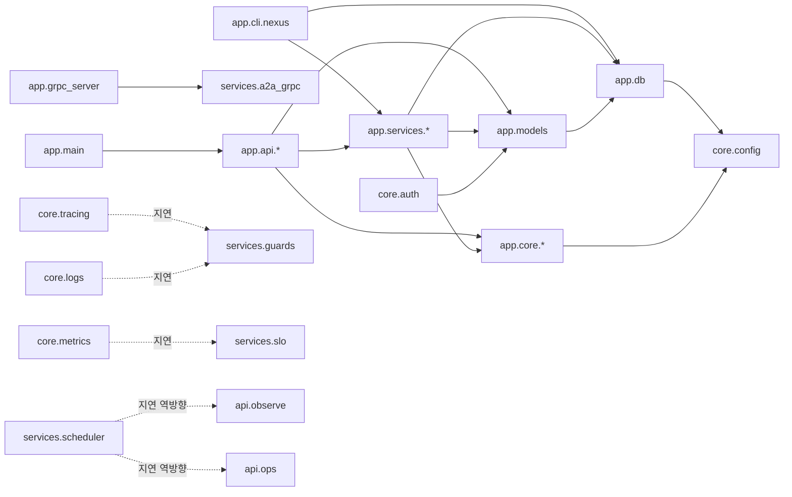
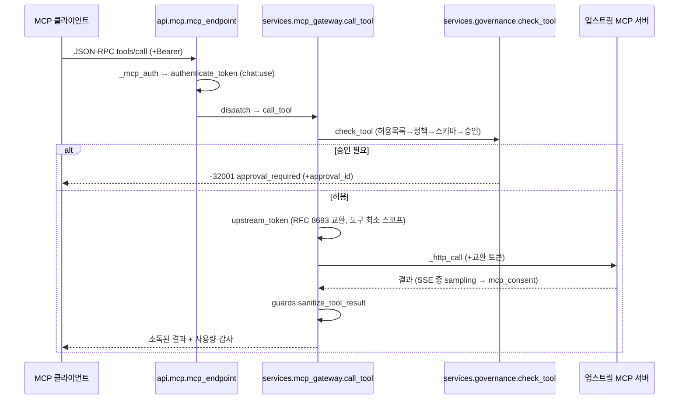

# 코드 단위 리뷰 보고서 / Line-by-Line Code Review
> 분석일 / Date: 2026-10-07 · 대상 / Target: `/Users/wise/Developer/wise-AgentNexus`
> 리뷰 레벨 / Level: 2 — ~3년 주니어 인수인계 수준 · 선택 파일 / Files: 40/237 · 분석 / Analyst: Claude
> 방법: `wds-review` code-method Step 1–8 · `max_files=40`·`max_lines_per_file=600`(초과는 블록 모드) · 제외: md/txt/lock/img/web·node_modules/dist·test/impl·로그

> **중요 — 스냅샷 고지(§1.6)**: 이 리뷰를 작성하는 동안 사용자가 같은 소스를 **동시에 수정**했다(품질 검토 반영, `test/test_review_fixes.py` = Epic 39). 재현성을 위해 선택 40개 파일을 **2026-10-07 14:03:12 KST 에 스냅샷**해 그 기준으로 라인 번호·인용을 고정했다. 스냅샷 이후 바뀐 파일: `app/core/auth.py`·`app/core/http.py`·`app/services/{mcp_gateway,a2a_gateway,mcp_tasks}.py`. 아래 §4.3 핫스팟 중 일부는 동시 작업으로 **이미 수정되었을 수 있다**(예: egress 가드·외부 IdP alg 허용 목록은 스냅샷에 반영됨). 각 지적은 "스냅샷 시점 코드" 기준이다.

---

## 1. 작업공간 인벤토리 / Workspace Inventory

**프로젝트**: AgentNexus — MCP + AI Gateway + A2A 통합 에이전트 플랫폼 (`wise-agentnexus` v0.1.0). FastAPI(Python 3.12) 백엔드 + React 19/Vite 콘솔 SPA, docker compose(local=SQLite · prod=PostgreSQL) 실행.

### 1.1 디렉터리·언어별 파일 수 (리뷰 대상, 기본 제외 적용)
| 영역 | 파일 수 | 주 언어 |
|---|--:|---|
| `app/` (core·api·services·builtin·cli + main·models·seed·db·grpc) | 83 py | Python |
| `test/` (impl 제외) | 38 py + 1 json | Python |
| `web/src/` | 46 ts/tsx + 1 css | TypeScript/React |
| `web/e2e/` | 21 ts | Playwright |
| `migrations/versions/` | 18 py | Alembic |
| `deploy/`(helm·k6)·`compose/`·`policies/`·`scripts/`·`.github/` | 약 30 | YAML·Rego·JS·sh |

### 1.2 매니페스트 · 락 · 진입점
- **매니페스트**: `pyproject.toml`(uv, 직접 의존 23 + dev 3), `web/package.json`(pnpm, 의존 11 + dev 20).
- **락파일**: `uv.lock`(121 패키지), `web/pnpm-lock.yaml`(335 resolution). (락파일은 리뷰 제외 — §2.4 는 매니페스트+락 교차 확인.)
- **진입점 후보**:
  1. `app/main.py` — `uvicorn app.main:app` (Dockerfile runtime CMD, compose `api`). **[리뷰 01]**
  2. `app/grpc_server.py` — `python -m app.grpc_server` (compose `a2a-grpc`). **[리뷰 02]**
  3. `app/cli/__main__.py` → `app/cli/nexus.py` — `nexus` CLI (Docker 래퍼). **[리뷰 03·04]**
  4. `app/builtin/mcp_servers.py` — `uvicorn …:app` (compose `mcp-servers`). **[리뷰 05]**
  5. `app/builtin/a2a_agent.py` — `uvicorn …:app` (compose `a2a-demo`). **[리뷰 06]**
  6. `web/src/main.tsx` — `web/index.html` 모듈 스크립트. **[리뷰 07·08]**
  7. `app/seed.py` — `python -m app.seed` (entrypoint). (부록)
- **테스트 러너**: pytest(`testpaths=["test"]`, `pythonpath=["."]`), vitest(web 단위), Playwright(web/e2e). CI(`.github/workflows/ci.yml`): `make preflight` → `make test` → compose build.

### 1.3 빌드·배포
- `Dockerfile` 멀티스테이지(base·dev·web-dev·web-build·e2e·runtime). runtime 은 non-root uid 10001, `UVICORN_WORKERS=2`, Prometheus multiprocess.
- `scripts/entrypoint.sh`: api 역할이면 `alembic upgrade head` + `python -m app.seed` 후 본 프로세스.
- compose: `docker-compose.yml`(공통) + `.local.yml`(SQLite·바인드) / `.prod.yml`(PostgreSQL). 네트워크 `edge`(공개) + `backend`(internal=true — FR-G00 우회 차단).

### 1.4 환경·시크릿 상태 (상시 점검)
- `.env.local`(시크릿 비움 → 커밋 가능), `.env.example`·`.env.prod` 템플릿(`CHANGE_ME`). **git 추적 상태**: `.gitignore` 가 `.env.prod`·`data/` 를 제외, `.env.local` 은 커밋 허용. 리포지터리는 단일 커밋(Initial commit) — 하드코딩 시크릿은 소스에 없음(시크릿은 Fernet 저장 또는 env 주입). 다만 작업 트리의 `.env.prod` 는 현재 16자 난수로 채워져 있고 `SIGNING_KEY_PEM` 이 PEM 이 아님(§4.3 참조).

---

## 2. 프로젝트 구조 / Project Structure

### 2.1 소스 트리 (깊이 4, 리뷰 대상)
```
app/
  main.py grpc_server.py models.py seed.py db.py
  core/    config auth http tracing metrics errors security keys logs context ids
  api/     mcp a2a gateway_admin observe ops catalog chat agents admin llm identity idp setup audit knowledge system
  services/ mcp_gateway mcp_modern mcp_tasks mcp_consent a2a_gateway a2a_proto a2a_rest a2a_grpc
            governance identity llm slo scheduler audit orchestrator registry graph providers
            ratelimit guards policy policy_review review setup a2a_server tls secrets totp notify …
  builtin/ mcp_servers a2a_agent demo_data demo_idp internal_system mcp_auth
  cli/     __main__ nexus
test/      conftest + test_*.py(38) + contract/
web/src/   main.tsx App.tsx  lib/{auth api sse i18n query format}  components/{Shell ui …}  pages/{15 영역}
migrations/versions/ 0001_initial … 0018_slo
deploy/{helm k6}  compose/  policies/  scripts/  .github/workflows/
```

### 2.2 모듈·패키지 의존 그래프 (내부 import, 패키지 수준)

정상 방향은 `api → services → core/models/db → config`. **점선 = 계층 위반(지연 import 로 가림)**: `core.{tracing,logs,metrics}` → `services.*`, `services.scheduler` → `api.{observe,ops}`.

내부 in-degree 상위(부하 모듈): `app.db`(79)·`app.models`(79/50)·`core.config`(47)·`core.http`(43)·`core.ids`(39)·`core.auth`(31)·`services.audit`(29)·`core.errors`(24).

### 2.3 호출·응답 흐름 (진입점별, 실제 함수명)
**(A) MCP 도구 호출 — `POST /mcp/{id}`**

**(B) A2A send — `POST /a2a/{id}`**: `api.a2a.a2a_proxy` → `a2a_gateway.proxy` → `_check`(신뢰 등급·정책·한도) → `_upstream_version`(0.3/1.0·바인딩) → `upstream_headers`(교환) → `_guard_out` → `_rpc`/`_stream` → `_sanitize_in` → `record`(Task 영속).
**(C) 채팅 실행**: `api.chat` → `services.orchestrator`(Planner→Retriever/Summarize→Executor, 승인 시 `gateway_admin.APPROVAL_HOOKS` → `on_approval` 재개). (orchestrator 는 부록.)

### 2.4 외부 패키지 인벤토리 (매니페스트 기준, 사용처 grep)
| 패키지 | 락 버전 | 사용 파일 수 | 역할 | 라이선스* |
|---|---|--:|---|---|
| fastapi | 0.142.2 | 25 | 웹 프레임워크 | MIT |
| starlette | (전이) | 34 | ASGI·응답·미들웨어 | BSD-3 |
| sqlalchemy | 2.1.3 | 84 | ORM | MIT |
| alembic | 1.20.0 | 23 | 마이그레이션 | MIT |
| pydantic / -settings | 2.13.5 / 2.15.0 | 16 / 1 | 검증·설정 | MIT |
| httpx | 0.28.1 | 31 | 아웃바운드 HTTP | BSD-3 |
| httpx2 | 2.13.1 (전이) | 2 | ASGI in-process(fastmcp 경유) | BSD-3 |
| pyjwt[crypto] | 2.15.1 | 12 | JWT | MIT |
| cryptography | 50.0.2 | 9 | Fernet·RSA·scrypt | Apache-2.0/BSD |
| fastmcp | 4.0.11 | 4 | MCP 서버·클라이언트 | Apache-2.0 |
| mcp | 2.3.0 (전이) | 3 | MCP 타입·inbound 규칙 | MIT |
| a2a-sdk | 1.2.2 | 3 | A2A proto 스텁·SDK | Apache-2.0 |
| grpcio | 1.84.0 | 2 | gRPC | Apache-2.0 |
| opentelemetry-* | 1.45.0 | 10 | 트레이싱·OTLP | Apache-2.0 |
| prometheus-client | 0.26.0 | 1 | 메트릭 | Apache-2.0 |
| redis | 8.1.0 | 1 | Valkey 레이트리밋 | MIT |
| jsonschema | 4.26.0 | 6 | 인자·정책 스키마 | MIT |
| pyyaml | 6.0.3 | 5 | OpenAPI·그래프 YAML | MIT |
| typer | 0.27.2 | 3(+test) | CLI | MIT |
| python-multipart | 0.0.32 | 0(직접) | 멀티파트(FastAPI File) | Apache-2.0 |
| psycopg[binary] | 3.3.6 | 0(직접) | PostgreSQL 드라이버(URL) | LGPL-3 |
| (dev) pytest 9.1.1 · ruff 0.16.10 · openai 3.24.0 | | | 시험·린트·시험용 클라이언트 | MIT/MIT/Apache-2.0 |

\* 라이선스는 패키지 공개 정보 기준(상세 감사는 depth-review `COMPLIANCE.md` 소관). `psycopg`(LGPL-3)·`redis` 프로토콜 서버는 Valkey(BSD-3)로 교체됨(COMPLIANCE §D6). `python-multipart`·`psycopg` 는 직접 import 는 없고 프레임워크·DB URL 경유 사용. 전이 의존 `httpx2` 를 소스가 직접 import 하면서 `pyproject.toml` 에 직접 선언하지 않은 점은 §4 참고.

### 2.5 데이터 흐름·상태 저장소
- **DB**(SQLite/PostgreSQL, SQLAlchemy): 약 50개 테이블 — Identity·Catalog·MCP·A2A·Run/Approval·Model/Routing·Policy/Limit/Secret·Usage/Audit/Span/Log·SLO·Setting·Attachment/KB. 마이그레이션 `0001~0018`. 범용 타입(JSON·Numeric·UTCDateTime)만 — 이식성.
- **캐시/큐**: Valkey(레이트리밋 토큰 버킷, `RATE_LIMIT_BACKEND=redis`), 워커 로컬 캐시(`_TOKENS`·`_UPSTREAM_SESSIONS`·`_JWKS`·서킷 브레이커). **워커 간 공유는 DB 폴링**(mcp_relays·run_events·sli_minutes·setting 리스)으로 구현.
- **파일**: `data/keys`(서명·암호화·OTLP 토큰), `data/attachments`, `data/audit-archive`·`reports`, `data/workloads`.
- **이벤트**: SSE(채팅·MCP 중계·A2A 스트림), OTLP/HTTP 수신기(`POST /v1/traces`).
- **설정 소스**: env(`core.config.settings` 싱글턴) + DB `Setting` 테이블(RBAC 재정의·보안 가드·리스·auth 정책).

### 2.6 진입점 목록 (번호·심볼·호출 방식)
1. `app/main.py:app` (HTTP, uvicorn) · 2. `app/grpc_server.py:main` (gRPC, `python -m`) · 3. `app/cli/__main__` → `nexus.py:main` (CLI) · 4. `app/builtin/mcp_servers.py:app` (HTTP, uvicorn) · 5. `app/builtin/a2a_agent.py:app` (HTTP, uvicorn) · 6. `web/src/main.tsx` (브라우저) · 7. `app/seed.py:run` (`python -m app.seed`, entrypoint) · 8. 테스트 `test/conftest.py:client` (pytest fixture).

---

## 3. 라인 리뷰 파일 선정 / Selected Files

선정 우선순위(method Step 3): ① 진입점 ② 진입점 2홉 내 도달 ③ 내부 in-degree 높은 부하 모듈 ④ 진입점 근접 테스트. `max_files=40` 상한.

| # | 파일 | LOC | 거리 | 선정 사유 | 리뷰 |
|--:|---|--:|:--:|---|---|
| 01 | `app/main.py` | 195 | 0 | 진입점 | [app/main.py.md](app/main.py.md) |
| 02 | `app/grpc_server.py` | 23 | 0 | 진입점 | [app/grpc_server.py.md](app/grpc_server.py.md) |
| 03 | `app/cli/__main__.py` | 3 | 0 | 진입점 | [app/cli/__main__.py.md](app/cli/__main__.py.md) |
| 04 | `app/cli/nexus.py` | 752 | 0 | 진입점(CLI 전체) | [app/cli/nexus.py.md](app/cli/nexus.py.md) |
| 05 | `app/builtin/mcp_servers.py` | 329 | 0 | 진입점(참조 서버) | [app/builtin/mcp_servers.py.md](app/builtin/mcp_servers.py.md) |
| 06 | `app/builtin/a2a_agent.py` | 192 | 0 | 진입점(데모 에이전트) | [app/builtin/a2a_agent.py.md](app/builtin/a2a_agent.py.md) |
| 07 | `web/src/main.tsx` | 34 | 0 | 진입점(SPA) | [web/src/main.tsx.md](web/src/main.tsx.md) |
| 08 | `web/src/App.tsx` | 179 | 1 | 라우팅 허브 | [web/src/App.tsx.md](web/src/App.tsx.md) |
| 09 | `app/core/config.py` | 90 | 1 | 부하(in-deg 47) | [app/core/config.py.md](app/core/config.py.md) |
| 10 | `app/db.py` | 80 | 1 | 부하(in-deg 79) | [app/db.py.md](app/db.py.md) |
| 11 | `app/core/auth.py` | 295 | 2 | 부하·보안 경계 | [app/core/auth.py.md](app/core/auth.py.md) |
| 12 | `app/core/http.py` | 225 | 2 | 부하(in-deg 43) | [app/core/http.py.md](app/core/http.py.md) |
| 13 | `app/core/tracing.py` | 226 | 1 | 부하·미들웨어 | [app/core/tracing.py.md](app/core/tracing.py.md) |
| 14 | `app/core/metrics.py` | 99 | 2 | 부하 | [app/core/metrics.py.md](app/core/metrics.py.md) |
| 15 | `app/core/errors.py` | 75 | 1 | 부하(in-deg 24) | [app/core/errors.py.md](app/core/errors.py.md) |
| 16 | `app/core/security.py` | 67 | 2 | 보안 경계 | [app/core/security.py.md](app/core/security.py.md) |
| 17 | `app/models.py` | 1036 | 1 | 부하(in-deg 79) | [app/models.py.md](app/models.py.md) |
| 18 | `app/services/mcp_gateway.py` | 1031 | 1 | 핵심 부하·보안 | [app/services/mcp_gateway.py.md](app/services/mcp_gateway.py.md) |
| 19 | `app/services/mcp_modern.py` | 415 | 2 | MCP 세대 | [app/services/mcp_modern.py.md](app/services/mcp_modern.py.md) |
| 20 | `app/services/mcp_tasks.py` | 221 | 2 | MCP Tasks | [app/services/mcp_tasks.py.md](app/services/mcp_tasks.py.md) |
| 21 | `app/services/mcp_consent.py` | 333 | 2 | 사람 동의 | [app/services/mcp_consent.py.md](app/services/mcp_consent.py.md) |
| 22 | `app/services/a2a_gateway.py` | 811 | 1 | 핵심 부하·보안 | [app/services/a2a_gateway.py.md](app/services/a2a_gateway.py.md) |
| 23 | `app/services/a2a_proto.py` | 345 | 1 | 코덱 부하(in-deg 14) | [app/services/a2a_proto.py.md](app/services/a2a_proto.py.md) |
| 24 | `app/services/a2a_rest.py` | 194 | 2 | REST 바인딩 | [app/services/a2a_rest.py.md](app/services/a2a_rest.py.md) |
| 25 | `app/services/a2a_grpc.py` | 254 | 1 | gRPC 바인딩 | [app/services/a2a_grpc.py.md](app/services/a2a_grpc.py.md) |
| 26 | `app/services/governance.py` | 318 | 2 | 승인·거버넌스 | [app/services/governance.py.md](app/services/governance.py.md) |
| 27 | `app/services/identity.py` | 196 | 2 | 토큰·교환 | [app/services/identity.py.md](app/services/identity.py.md) |
| 28 | `app/services/llm.py` | 425 | 2 | Unified Model API | [app/services/llm.py.md](app/services/llm.py.md) |
| 29 | `app/services/slo.py` | 156 | 1 | SLO·예산 | [app/services/slo.py.md](app/services/slo.py.md) |
| 30 | `app/services/scheduler.py` | 141 | 1 | 예약·리스 | [app/services/scheduler.py.md](app/services/scheduler.py.md) |
| 31 | `app/services/audit.py` | 242 | 2 | 감사 체인(in-deg 29) | [app/services/audit.py.md](app/services/audit.py.md) |
| 32 | `app/api/mcp.py` | 760 | 1 | MCP 라우터 | [app/api/mcp.py.md](app/api/mcp.py.md) |
| 33 | `app/api/a2a.py` | 719 | 1 | A2A 라우터 | [app/api/a2a.py.md](app/api/a2a.py.md) |
| 34 | `app/api/gateway_admin.py` | 835 | 1 | 게이트웨이 관리 | [app/api/gateway_admin.py.md](app/api/gateway_admin.py.md) |
| 35 | `app/api/observe.py` | 471 | 1 | 관측 라우터 | [app/api/observe.py.md](app/api/observe.py.md) |
| 36 | `web/src/lib/auth.tsx` | 168 | 1 | 콘솔 인증 | [web/src/lib/auth.tsx.md](web/src/lib/auth.tsx.md) |
| 37 | `web/src/lib/api.ts` | 78 | 1 | REST 클라이언트 | [web/src/lib/api.ts.md](web/src/lib/api.ts.md) |
| 38 | `test/conftest.py` | 106 | — | 시험 인프라 | [test/conftest.py.md](test/conftest.py.md) |
| 39 | `test/test_mcp.py` | 296 | — | 진입점 근접 시험 | [test/test_mcp.py.md](test/test_mcp.py.md) |
| 40 | `test/test_a2a.py` | 306 | — | 진입점 근접 시험 | [test/test_a2a.py.md](test/test_a2a.py.md) |

> 18·22 는 스냅샷 시점 1031·811 LOC(종합 당시 디스크는 1041·819). 블록 모드 적용 파일: 04·17·18·22·32·33·34(600 초과).

디렉터리 개요: [app](app/app_Abstract.md) · [core](app/core/core_Abstract.md) · [services](app/services/services_Abstract.md) · [api](app/api/api_Abstract.md) · [builtin](app/builtin/builtin_Abstract.md) · [cli](app/cli/cli_Abstract.md) · [web/src](web/src/src_Abstract.md) · [web/src/lib](web/src/lib/lib_Abstract.md) · [test](test/test_Abstract.md)

---

## 4. 종합 분석 / Synthesis (Step 7)

### 4.1 반복 패턴 (3+ 파일)
1. **분리 스냅샷 + run_in_threadpool**: `ServerRef`(mcp_gateway)·`AgentRef`(a2a_gateway)로 ORM 행을 복사해 비동기 구간에서 세션 없이 쓰고, 동기 DB 는 `run_in_threadpool` 로 분리 — 전 서비스 일관(좋은 패턴).
2. **워커 로컬 캐시(만료 30초 전 갱신)**: `_TOKENS`·`_JWKS`·업스트림 세션·서킷 브레이커 — mcp_gateway·a2a_gateway·auth·llm. 상한·single-flight 가 없어 thundering herd·무제한 증가 소지(동시 작업으로 `_cache_token` 상한 일부 추가됨).
3. **DB 폴링으로 워커 간 공유**: 동의 결과·MRTR·Task·SLI·리스를 0.2초 폴링 또는 조건부 UPDATE 로 공유(mcp_consent·mcp_modern·mcp_tasks·a2a_gateway·slo·scheduler). 다중 워커 복구에는 견고하나 폴링 DB 부하.
4. **클라이언트 헤더를 신뢰 입력으로**: `X-AgentNexus-Agent`·`-Data-Class`·`-Session/Run/Step` 을 정책·데이터 등급·이벤트 기록에 그대로(api.mcp·api.a2a → mcp_gateway·a2a_gateway·mcp_consent·governance·policy). 공통 신뢰 경계 취약점.
5. **사용자 병합 가능한 `auth` JSON**: MCP 서버·A2A 에이전트의 `auth`(secret_ref·endpoint·token_url)를 관리 API 가 요청 본문째 병합 — 핫스팟 #1 의 뿌리.
6. **조용한 예외 삼킴**: `contextlib.suppress(Exception)`·`except Exception: pass` 가 백그라운드 루프·푸시 중계·캐시 읽기 다수(main·a2a_gateway·auth.rbac·mcp_gateway.probe). 장애 원인 추적을 어렵게 함.
7. **상태 전이의 비원자성**: 승인 소비·결정·연장·refresh 회전이 읽기-수정-쓰기(조건부 UPDATE 아님) — governance·identity. 대조적으로 `scheduler.lease`·`audit.append` 는 원자적(모범).

### 4.2 계층 위반 (2.2 의도 위배 import)
- `core.tracing`·`core.logs`·`core.metrics` → `services.{guards,slo}` (지연 import 로 가림, 마스킹 함수를 core 로 내려야 함).
- `services.scheduler` → `api.observe`·`api.ops` (서비스가 API 를 호출 — `evaluate`·`run_scheduled_backup` 을 서비스로 이동 필요).
- `app.main` 이 모든 api 라우터를 무조건 import → 라우터 모듈의 import 부수효과(`@registry.register_handler`)가 구성요소와 무관하게 실행.

### 4.3 위험 핫스팟 Top-5
1. **[높음] 사용자 병합 가능한 `auth` 로 임의 시크릿 외부 전송** — `services.mcp_gateway`(L124-155, L690-767)·`services.a2a_gateway`(L243-294)·`api.mcp`(patch_server/test_config)·`api.a2a`(patch_agent). `mcp:write`/`a2a:write`(developer 역할 포함)만으로 `secret_ref` 를 다른 기능의 시크릿 이름으로·`endpoint`/`token_url` 을 외부 주소로 바꿔 게이트웨이가 저장된 시크릿을 외부로 Bearer 전송하게 할 수 있다. 객체 수준 인가 부재와 결합.
2. **[높음] 업스트림 발견 외부 AS 에 사용자 원본 토큰 전송 + 업스트림 지정 URL 조회** — `services.mcp_gateway._external_token`(L172 `subject_token=p.raw_token`)·`discover_auth`(L200-234). oauth2 업스트림이 내려 준 메타데이터 URL 로 사용자 액세스 토큰/PAT 를 보내고 임의 URL 을 GET(블라인드 SSRF).
3. **[중간] 클라이언트 웹훅·카드·OpenAPI URL SSRF** — `services.a2a_proto.push_config_of`(검증 없음)·`a2a_gateway.receive_push`(L771-775, 조용한 실패)·`api.mcp.fetch_openapi`·gRPC 원격 주소(평문·가드 미적용). egress 가드가 링크 로컬·IMDS 만 막아 내부 서비스(db·valkey·api)는 열림. 푸시는 본문 task id 를 검증하지 않아 다른 Task 조작 가능.
4. **[중간] 사람 승인 통제의 경합·우회** — `services.governance`(승인 소비 TOCTOU → 고위험 도구 이중 실행; 새 도구·업스트림 annotations 자동 허용)·`api.gateway_admin`(정책 초안 수정자 미기록 → 2인 검토 우회). `services.identity`(교환에 주체 권한 검사 없음 + 공개 token-exchange grant → 네트워크 격리 없으면 게이트웨이 승인 우회).
5. **[중간] 관측 집계의 전체 행 메모리 로드** — `api.observe.summary_data`·`evaluate`·`usage`·`_overview_extra`(N+1). 기간 내 UsageRecord/RunEvent/Span 전부를 Python 집계, 알림 규칙마다 재계산. 데이터 증가 시 지연·메모리·DB 부하.

보조 핫스팟: `core.config` `app_env` 기본 `local`(fail-open)·`seed_demo` 기본 True; `models` JSON 제자리 변경 미추적·`push_config.token` 평문; `audit` 단일 머리 직렬화 처리량·리포트 서명 키 공유.

### 4.4 삭제·정리 후보
- `services.mcp_consent.WAIT_STATES`(L27) — 저장소 전역에서 미참조.
- `core.http.StreamingASGITransport` 의 `start["error"]`(L187) — 저장만 하고 미사용.
- `cli/nexus.py:752` `sys.exit(0)` — typer 가 이미 SystemExit(도달 불가).
- 중복 코드: `_cache_token`(mcp_gateway·a2a_gateway 동일), 함수 내 `import asyncio`/`import re` 중복.

### 4.5 테스트 공백
- **경합·음성 케이스**: 동시 승인 이중 사용(governance TOCTOU), refresh token 재사용 탐지, 푸시 본문 task id 위조, 정책 초안 수정자 우회 — 현재 시험은 정상 흐름 위주.
- **시크릿 유출 경로**: `auth.secret_ref` 를 다른 네임스페이스로 지정해 외부 전송되는지 검증하는 시험 없음(핫스팟 #1·#2). `test/test_review_fixes.py`(Epic 39)가 egress·alg·subject 등 일부를 이미 커버 — 나머지 핫스팟도 회귀 시험 필요.
- **성능 회귀**: 관측 집계·구독 폴링의 대량 데이터 부하는 in-process 시험으로 드러나지 않음.
- 공유 DB·세션 범위 fixture 로 인한 시험 순서 의존(일부만 `finally` 복원).

### 4.6 다음 단계 (구체적·순서)
1. **핫스팟 #1·#2 차단(최우선)**: MCP·A2A `auth` 를 pydantic 스키마로 제한(`secret_ref` 직접 입력 금지, `secret` 으로만), `secret_ref` 를 서버/에이전트 전용 네임스페이스로 고정, `endpoint`/`token_url` 변경에 재승인·소유권(객체 인가) 요구. 외부 AS 는 운영자 등록 허용 목록만, 원본 토큰 대신 audience 한정 교환 토큰 전송. → `test_review_fixes.py` 에 회귀 시험 추가.
2. **SSRF 경계 통일(#3)**: 사용자 입력 URL(푸시 웹훅·카드·OpenAPI fetch·gRPC 원격)에 공통 egress 정책(사설 대역·루프백 차단 옵션 + 해석 IP 직접 연결로 재바인딩 차단) 적용, 푸시는 본문 task id 일치 확인·서명 기본 요구·실패 감사.
3. **사람 승인·토큰 통제 원자화(#4)**: 승인 소비·결정·연장·refresh 회전을 `UPDATE … WHERE status=:expected`(rowcount) 로, 새 도구 기본 `allowed=False`(또는 신뢰 등급별 annotations 신뢰), 정책 초안 `updated_by` 기록·token-exchange grant 클라이언트 인증.
4. **관측 집계 재설계(#5)**: `summary_data`·`usage` 를 SQL `GROUP BY`/사전 집계 테이블로, 알림 평가는 요약 1회 공유, OTLP 수신 크기 상한·스팬 INSERT-only.
5. **설정 안전 기본값**: `app_env` 기본 `prod`·`seed_demo` 기본 False, 시크릿 필드 `SecretStr`, `write_env` 의 `SIGNING_KEY_PEM` 처리 수정(비우거나 RSA PEM 생성).
6. **계층·관측 정리**: 마스킹을 core 로, scheduler 의 API 호출을 서비스로 이동; 백그라운드 루프의 `suppress(Exception)` 을 로그 있는 처리로; 헬스 루프·A2A 감시기에 리스 적용.

---

## 5. 부록 / Appendix

### 부록 A — 미선택 파일 (라인 리뷰 없음, 197개)
> 역할은 모듈 docstring/첫 주석 1줄. 전체 표는 아래.

> 미선택 파일(라인 리뷰 없음) — `max_files=40` 상한 초과분. 역할은 모듈 docstring/첫 주석 1줄.

#### `.github/workflows/` — 1개
| 파일 | LOC | 역할 |
|---|--:|---|
| `ci.yml` | 13 |  |

#### `app/` — 2개
| 파일 | LOC | 역할 |
|---|--:|---|
| `__init__.py` | 0 |  |
| `seed.py` | 391 | wise-agentnexus — 시드 (make db-seed · entrypoint 자동 실행). 모두 멱등(idempotent). |

#### `app/api/` — 13개
| 파일 | LOC | 역할 |
|---|--:|---|
| `__init__.py` | 1 |  |
| `admin.py` | 518 | 운영·설정 API (FR-P02·W01·W03·P04 · SCR-A05~A09·B03·B04·B05·L01~L06). |
| `agents.py` | 613 | 에이전트 프로파일·오케스트레이션 템플릿 API (FR-A02·W02·W04·A05 · SCR-D01~D08·D10). |
| `audit.py` | 301 | 감사 로그 조회·해시 체인 검증 (FR-O05, SCR-K09). |
| `catalog.py` | 737 | 통합 카탈로그 · MCP Registry API (FR-P01, C00~C03, P04 · SCR-E01~E08). |
| `chat.py` | 665 | 자연어 진입·실행 API (FR-A00·A01·A02·W05 · SCR-C01~C08·D08·D09). |
| `identity.py` | 490 | Identity & Authorization 관리 API (SCR-B06·I05·J01~J07·L03). |
| `idp.py` | 415 | 내장 IdP (FR-I00·I01) — OIDC 발급자. 외부 IdP(Keycloak·Entra ID·Okta)가 없을 때의 기본 IdP 이자, |
| `knowledge.py` | 136 | 지식 베이스 API (FR-A02.2 RAG) — 관리(agents:write)·검색(chat:use, 팀 범위). Retriever 의 `kb` 단계가 search 를 부른다. |
| `llm.py` | 520 | Unified Model API (OpenAI 호환) + 공급자·모델·라우팅 관리 (FR-G06·G01, FR-L00~L02 · SCR-H02·H13·I01~I04). |
| `ops.py` | 1036 | 운영·관측 화면 깊이 API (Epic 23 · SCR-B02~B07·H01~H15·I02~I05·J03·J04·J06·K01~K10·L02~L06·F01·F02). |
| `setup.py` | 461 | 첫 실행 마법사 API (SCR-A05~A09, FR-P02·I00·L00·C00·O00·W04). |
| `system.py` | 31 | 시스템 정보 (SCR-B05·L04 기초) · 전역 배너 (CMP-16). |

#### `app/builtin/` — 5개
| 파일 | LOC | 역할 |
|---|--:|---|
| `__init__.py` | 1 |  |
| `demo_data.py` | 59 | 데모 참조 서버용 가상 데이터 (UI 설계서 와이어프레임과 같은 가상 조직 '한결테크' · 프로젝트 ORION). 실제와 무관. |
| `demo_idp.py` | 112 | 데모 외부 IdP (local·test 전용) — 콘솔 SSO 브로커(FR-I00·I01)를 실제 OIDC 흐름으로 시연·시험하기 위한 작은 OIDC 공급자. |
| `internal_system.py` | 41 | 데모 '내부 시스템' REST API (FR-S02 대상) — Internal API MCP Server 가 OpenAPI 로 도구화한다. |
| `mcp_auth.py` | 106 | MCP 서버 측 인가 (FR-I03 · MCP Authorization: OAuth 2.1 Resource Server, RFC 9728 Protected Resource Metadata). |

#### `app/cli/` — 1개
| 파일 | LOC | 역할 |
|---|--:|---|
| `__init__.py` | 1 |  |

#### `app/core/` — 5개
| 파일 | LOC | 역할 |
|---|--:|---|
| `__init__.py` | 0 |  |
| `context.py` | 17 | 요청 컨텍스트 — trace_id 등 (OTel 활성 스팬이 있으면 그 trace_id 우선). |
| `ids.py` | 30 | 식별자·해시 유틸. |
| `keys.py` | 85 | 서명 키(RS256, JWKS)·암호화 키(Fernet) — env 우선, 없으면 data_dir/keys 에 생성·보존. |
| `logs.py` | 112 | 구조화 로그 (FR-O02, NFR-PRV1) — JSON 출력, trace_id 연계, PII·시크릿 마스킹, 주요 이벤트 DB 영속(SCR-K04). |

#### `app/services/` — 24개
| 파일 | LOC | 역할 |
|---|--:|---|
| `__init__.py` | 1 |  |
| `a2a_server.py` | 361 | A2A 서버 엔진 (FR-A05 플랫폼 A2A 서버 · 데모 원격 에이전트 공용) — JSON-RPC 0.3/1.0 동시 수용. |
| `attachments.py` | 141 | 채팅 첨부 (FR-A01, SCR-C01) — 원본은 data/attachments 에 두고 요약 근거용 텍스트를 추출한다. |
| `broker.py` | 161 | 외부 IdP 로그인 브로커 (FR-I00·I01, SCR-A10·J02) — 내장 IdP 가 Keycloak 처럼 외부 OIDC(Entra·Okta·Keycloak)로 |
| `deploy.py` | 134 | 배포 프로파일·에어갭 (FR-W01·P02, SCR-L01·A01, ST-09·CMP-16). |
| `graph.py` | 433 | 에이전트 프로파일 그래프 정의 (FR-A02·W02, SCR-D02~D07) — YAML/JSON 스키마·참조 검증(오류 줄 번호). |
| `guards.py` | 280 | Security 가드 (FR-G02·G07, NFR-PRV1) — 입력·출력 PII 마스킹, 프롬프트 인젝션 탐지, 도구 응답 소독(간접 인젝션). |
| `knowledge.py` | 176 | 지식 베이스 · 내장 벡터 색인 (FR-A02.2 RAG, PRD D12) — 문서 → 청크 → 임베딩(llm.embed_texts, 게이트웨이와 같은 |
| `mcp_template.py` | 299 | Custom MCP Server 템플릿 (FR-S03, SCR-F05) — FastMCP 기반 독립 프로젝트 파일 세트를 생성한다. |
| `notify.py` | 44 | 알림 센터 (SCR-B04) — 승인 대기·예산·카드 변경·장애 등. dedupe_key 로 중복 억제. |
| `orchestrator.py` | 1137 | Local Agent Orchestration (FR-A00~A02, FR-W02·W05) — Agent Application / MCP Host. |
| `policy.py` | 157 | Policies (FR-G03) — 누가(사용자·그룹·역할·팀·에이전트) 어떤 모델·도구·에이전트를 어떤 인자로 호출 가능한가. |
| `policy_review.py` | 128 | 정책 게시 심사 (SCR-H07·H08, FR-G03·O05) — 초안 → 회귀 시험(케이스 + 최근 실제 요청 재평가) → 게시 요청(사유) → 작성자 외 승인. |
| `profiles.py` | 27 | 에이전트 프로파일 공용 — 그래프 적용(허용 도구·원격 에이전트·모델 동기화)·카탈로그 노출(FR-P01). |
| `providers.py` | 409 | LLM 공급자 어댑터 (FR-L00~L02, FR-G06) — 모든 어댑터는 OpenAI Chat Completions 형식으로 정규화한다. |
| `ratelimit.py` | 277 | Rate limits · 예산 (FR-G04) — 사용자·에이전트·팀·클라이언트 키 × 모델·도구·에이전트 단위 |
| `registry.py` | 575 | MCP Registry / 통합 카탈로그 (FR-P01, FR-C00~C03, FR-P04). |
| `retention.py` | 39 | 보존 정책 (FR-O02 보존, COMPLIANCE: 텔레메트리 보관/삭제 검증 CC6.5/A.8.10). |
| `review.py` | 201 | 등록 심사 (SCR-E04·E05·E07·G02·D10, FR-C02·G07·R00·A05) — 승인 대기열 점검·도구 위험도·스코프·버전 diff·승인 효과. |
| `runmeta.py` | 66 | 실행 메타 (SCR-C03 ⑦⑧ · C06 ⑥⑦ · D08 ⑤⑥) — 토큰·비용·첫 토큰·노드별 지연/비용·폴백·한도 초과·응답 소독·근거 사용. |
| `secrets.py` | 67 | 시크릿 저장소 (FR-G02, SCR-H06) — Fernet 암호화. 평문은 저장·로그·API 응답에 남기지 않는다. |
| `setup.py` | 219 | 첫 실행 마법사 (SCR-A05~A09) — 일회용 설정 코드 · 진행 상태(서버 저장) · 비밀번호 정책 · 템플릿 60초 자가 시험. |
| `tls.py` | 94 | 업스트림 mTLS (FR-G02) — MCP 서버·원격 A2A 에이전트·LLM 공급자별 TLS 설정 → ssl.SSLContext. |
| `totp.py` | 35 | TOTP (RFC 6238 · HMAC-SHA1 · 30초 · 6자리) — 첫 실행 관리자 MFA (SCR-A05), 표준 라이브러리만. |

#### `compose/` — 3개
| 파일 | LOC | 역할 |
|---|--:|---|
| `ollama.yml` | 20 | 로컬 모델 (선택, profile=ollama) — 에어갭 배포 프로파일(L01 airgap)의 로컬 LLM (FR-L02·P02, NFR-D1). |
| `opa.yml` | 9 | OPA (선택, profile=opa) — POLICY_ENGINE=opa 일 때 게이트웨이가 policies/agentnexus.rego 로 판정 (FR-G03 어댑터). |
| `valkey.yml` | 14 | Valkey (BSD-3, Redis 프로토콜 호환) — 레이트리밋 토큰 버킷 카운터 (FR-G04). make 가 compose/*.yml 을 자동 포함한다. |

#### `deploy/helm/` — 1개
| 파일 | LOC | 역할 |
|---|--:|---|
| `check-rendered.py` | 95 | helm template 결과 오프라인 정합성 검사 (클러스터·인터넷 불필요). |

#### `deploy/helm/agentnexus/` — 3개
| 파일 | LOC | 역할 |
|---|--:|---|
| `Chart.yaml` | 12 |  |
| `values.schema.json` | 33 |  |
| `values.yaml` | 155 | AgentNexus Helm values — docker compose(prod) 와 같은 구성을 Kubernetes 로. 시크릿은 values 에 평문으로 넣지 말고 existingSecret 권 |

#### `deploy/helm/agentnexus/ci/` — 3개
| 파일 | LOC | 역할 |
|---|--:|---|
| `airgap-values.yaml` | 7 | 에어갭: 사설 레지스트리 · 데모 끔 · 외부 SaaS 없음 |
| `gateway-only-values.yaml` | 3 | 독립 실행(FR-W01): AI 게이트웨이 단독 |
| `ha-values.yaml` | 11 | 고가용성: HPA + PDB + RWX 볼륨 + 외부 DB·Valkey + OPA + Gateway API + ServiceMonitor |

#### `deploy/helm/agentnexus/files/` — 1개
| 파일 | LOC | 역할 |
|---|--:|---|
| `agentnexus.rego` | 65 | AgentNexus 게이트웨이 정책 (OPA) — PRD 9.2 예시를 POLICY_ENGINE=opa 입력 형식에 맞춘 기준 정책. |

#### `deploy/helm/agentnexus/templates/` — 9개
| 파일 | LOC | 역할 |
|---|--:|---|
| `_helpers.tpl` | 63 |  |
| `api.yaml` | 112 |  |
| `configmap.yaml` | 42 |  |
| `datastores.yaml` | 163 |  |
| `demo.yaml` | 64 |  |
| `exposure.yaml` | 105 |  |
| `networkpolicy.yaml` | 34 | backend(참조 MCP·A2A·DB·Valkey·OPA) 는 api 파드에서만 수신 — compose 의 internal backend 네트워크와 같은 우회 차단 (FR-G00) |
| `scaling.yaml` | 27 |  |
| `secret.yaml` | 31 |  |

#### `deploy/helm/agentnexus/templates/tests/` — 1개
| 파일 | LOC | 역할 |
|---|--:|---|
| `test-health.yaml` | 25 |  |

#### `deploy/k6/` — 3개
| 파일 | LOC | 역할 |
|---|--:|---|
| `chaos.js` | 33 | NFR-A1 장애 주입 중 가용성 (k6) — 일정 도착률로 모델·MCP 호출을 유지하고, 같은 시간에 워커·공급자·Valkey·DB 장애를 주입한다. |
| `gateway.js` | 46 | NFR-P1 게이트웨이 지연 부하 시험 (k6) — Unified Model API · MCP 프록시 · 첫 토큰(SSE) |
| `sessions.js` | 55 | NFR-S1 동시 세션 시험 (k6) — 1,000 개의 MCP 클라이언트 세션을 동시에 유지하며 도구를 호출한다. |

#### `migrations/` — 2개
| 파일 | LOC | 역할 |
|---|--:|---|
| `env.py` | 46 | Alembic env — DATABASE_URL(설정) 사용, 모델 메타데이터 자동 감지. |
| `script.py.mako` | 22 |  |

#### `migrations/versions/` — 18개
| 파일 | LOC | 역할 |
|---|--:|---|
| `0001_initial_schema.py` | 980 | initial schema |
| `0002_catalog_version_status.py` | 36 | catalog version status |
| `0003_approver_role.py` | 36 | approver role |
| `0004_a2a_push_config.py` | 30 | a2a push config |
| `0005_run_graph_snapshot.py` | 32 | run graph snapshot |
| `0006_mcp_consent_relay.py` | 43 | mcp consent payload/result and relay table |
| `0007_rag_attachments_recovery.py` | 100 | attachments, knowledge bases (RAG), run heartbeat, model quality |
| `0008_idp_broker.py` | 51 | external IdP SSO broker: idp login fields, broker requests |
| `0009_user_mfa.py` | 26 | user TOTP MFA |
| `0010_registration_review.py` | 93 | registration review: version pin, source filters, card cache & checks, agent card publish, policy drafts & tes |
| `0011_chat_editor_depth.py` | 50 | chat & editor depth: message feedback/branches, session source, dry-run test runs, code-only draft, per-step u |
| `0012_ops_depth.py` | 53 | ops depth: session cutoff & claims, approval delegation, args-schema mode, audited log unmask, settings histor |
| `0013_a2a_task_events.py` | 24 | a2a task events: state transitions and send/sse/push/poll event log (SCR-G06) |
| `0014_design_gaps.py` | 48 | design gaps: routing rule versions, per-key allowed models, A2A framework (SCR-H02·H13·G01) |
| `0015_mcp_upstream_protocol.py` | 26 | MCP upstream protocol: per-server preference (auto/legacy/2026-07-28) + detected version (D14-②) |
| `0016_approval_extensions.py` | 24 | approval time extension count (D14-③, WCAG 2.2.1 Timing Adjustable) |
| `0017_mcp_tasks.py` | 42 | MCP Tasks extension (io.modelcontextprotocol/tasks, SEP-2663) — gateway-run long tool calls (D15-①) |
| `0018_slo.py` | 55 | SLO · error budget: SLO definitions + per-worker per-minute SLI counters (D15-④) |

#### `policies/` — 1개
| 파일 | LOC | 역할 |
|---|--:|---|
| `agentnexus.rego` | 65 | AgentNexus 게이트웨이 정책 (OPA) — PRD 9.2 예시를 POLICY_ENGINE=opa 입력 형식에 맞춘 기준 정책. |

#### `scripts/` — 1개
| 파일 | LOC | 역할 |
|---|--:|---|
| `entrypoint.sh` | 11 | bin/sh |

#### `test/` — 35개
| 파일 | LOC | 역할 |
|---|--:|---|
| `__init__.py` | 0 |  |
| `test_a2a_grpc.py` | 203 | Epic 37 — A2A gRPC 바인딩 (D16-②): 정규 lf.a2a.v1.A2AService 수신(게이트웨이 REST 로 위임 — 같은 인증·정책·감사) · |
| `test_a2a_rest.py` | 166 | Epic 36 — A2A HTTP+JSON(REST) 바인딩 (D16-①): 게이트웨이·플랫폼 수신 REST(같은 정책·감사·Task 영속) · |
| `test_a2a_v10.py` | 71 | Epic 33 — A2A 1.0 기본화 (D15-②): 시스템·업데이트 정보 1.0 기본 · 카드 1.0 인터페이스 우선(0.3 필드 유지) · |
| `test_admin.py` | 186 | Epic 10 — 독립 실행·연동·운영 (FR-P02·W01·W03·P04, SCR-A05~A09·B03~B05·L01~L06). |
| `test_catalog.py` | 207 | Epic 3 — 카탈로그·레지스트리 (FR-P01, C00~C03, P04). |
| `test_chat_editor.py` | 433 | Epic 22 — 채팅·오케스트레이션 편집기 깊이 (SCR-C01~C07 · D01~D09). |
| `test_cli.py` | 163 | Epic 11 — CLI `nexus` (FR-P03·S03, SCR-A01·A04·A11·E04·F05). TestClient 를 HTTP 로 주입해 in-process 실행. |
| `test_cli_install.py` | 128 | Epic 20 — CLI 설치·컨텍스트·감사·번들 (SCR-A01·A02·A04·A11). |
| `test_contract.py` | 39 | OpenAPI 계약 테스트 (COMPLIANCE ict-saas testing_additions: OpenAPI 계약 적합성). |
| `test_deploy.py` | 34 | Epic 13 — 배포 산출물 정합성 (Helm 차트 ↔ 앱 · 정책 사본). 렌더 검증은 make helm-check (helm 필요). |
| `test_design_gaps.py` | 197 | Epic 24 — 남은 설계 요소 (D13-①): H02 라우팅 규칙 버전·게시·되돌리기 · H13 키별 허용 모델 · F04 hosted OpenAPI OBO · |
| `test_extend.py` | 132 | Epic 30 — 동의·승인 시간 연장 (D14-③, WCAG 2.2.1 Timing Adjustable): 한 번에 기본 시간만큼(동의 60초 · 도구 승인 30분), |
| `test_foundation.py` | 103 | Epic 1 — 기반: 마이그레이션, 감사 해시 체인, 공통 오류, OpenAPI 계약. |
| `test_gateway_policy.py` | 321 | Epic 4 — 게이트웨이 정책 코어 (FR-G02·G03·G04·G07). |
| `test_hardening.py` | 201 | Epic 17 — 보안·정합성 결함 (FR-G02·G04·L03·I04, NFR-SEC1·PRV1). |
| `test_health.py` | 9 |  |
| `test_identity.py` | 245 | Epic 2 — Identity & Authorization (FR-I00~I04, L03). |
| `test_llm.py` | 318 | Epic 5 — Unified Model API (FR-G06·G01·G04·G05, FR-L00~L02). |
| `test_mcp_consent.py` | 276 | Epic 14 — MCP 서버→클라이언트 요청 (FR-A00·A03·G09, SCR-C08): Host 동의(sampling·elicitation)·하류 중계·`/` 메뉴. |
| `test_mcp_modern.py` | 148 | Epic 27 — MCP 2026-07-28 수용 (D13-④): 게이트웨이 `/mcp/{id}` dual-era — stateless 요청(_meta 버전·능력), server/discover, |
| `test_mcp_modern_ext.py` | 249 | Epic 29 — MCP 2026-07-28 확장 (D14-②): 게이트웨이 → modern 업스트림 stateless 호출(server/discover 로 발견, 서버별 auto/legacy/20 |
| `test_mcp_tasks.py` | 237 | Epic 32 — MCP 2026-07-28 리소스 구독·Tasks 확장 (D15-①): listen `resourceSubscriptions` → notifications/resources/upd |
| `test_mtls.py` | 197 | Epic 15 — 업스트림 mTLS (FR-G02): MCP 서버·LLM 공급자·원격 A2A 에이전트에 클라이언트 인증서로 접속. |
| `test_nfr.py` | 19 | Epic 25 — NFR-A1 장애 시 동작: Valkey 가 끊겨도 한도 검사가 오류를 내지 않고(워커 로컬 버킷) 5초 뒤 다시 시도한다. |
| `test_observe.py` | 246 | Epic 9 — Observability & Audit (FR-O00~O05, FR-G05, COMPLIANCE testing_additions). |
| `test_ops.py` | 547 | Epic 23 — 운영·관측 화면 깊이 (SCR-B02~B07 · H01~H15 · I05 · J03·J04·J06 · K01~K10 · L02~L06 · F01·F02·F04·F05). |
| `test_orchestration.py` | 339 | Epic 8 — Agent App/MCP Host · Local Agent Orchestration (FR-A00~A02, FR-W02·W04·W05, FR-A05). |
| `test_perf.py` | 84 | NFR-P1 게이트웨이 추가 지연 측정 — mock 공급자(지연 0)·in-process MCP 서버이므로 측정 시간 ≈ 게이트웨이 자체 처리 시간. |
| `test_reliability.py` | 381 | Epic 18 — 오케스트레이션 신뢰성·확장 (FR-A01·A02·W02·R02~R04·A05·O02·O03·G01·S00, NFR-S1). |
| `test_review.py` | 359 | Epic 21 — 등록 → 심사 → 사용 (SCR-E01~E07 · G02/G03 · D10 · F03 · H07/H08). |
| `test_review_fixes.py` | 410 | Epic 39 — 품질 검토 반영 (D16-④): .review/ 위임·심층 리뷰에서 확인된 결함의 회귀 시험. |
| `test_setup.py` | 198 | Epic 20 — 첫 실행 마법사·설치 (SCR-A05~A09·L01, ST-09·CMP-16, FR-P02·W01·W04). |
| `test_slo.py` | 108 | Epic 35 — SLO·오류 예산 (D15-④): 데이터 경로 분류 · 워커별 분 단위 카운터 누적 · 30일 이동 창 SLI·예산 잔량 · |
| `test_sso.py` | 143 | Epic 19 — 외부 IdP SSO 로그인 브로커 (FR-I00·I01, SCR-A10·J01·J02) — 데모 외부 IdP(/_demo/oidc)로 실제 OIDC 흐름. |

#### `web/e2e/` — 22개
| 파일 | LOC | 역할 |
|---|--:|---|
| `a11y-dark.spec.ts` | 49 | Epic 28 — 어두운 테마 접근성 (D14-①): 시스템 다크(prefers-color-scheme) · 명시 다크(anx.theme=dark) 에서 axe 위반 0 |
| `a11y-shared.ts` | 47 | 접근성 점검 공용 — 화면 목록·axe 스캔 (a11y.spec · a11y-dark.spec) |
| `a11y.spec.ts` | 52 | Epic 26 — 접근성 (D13-③): KWCAG 2.2 + WCAG 2.2 AA — axe-core 자동 점검(전 화면) + 키보드·포커스·건너뛰기 링크 · 시드 계정 local/test 전용 |
| `a2a-v10.spec.ts` | 25 | Epic 33 — A2A 1.0 기본화 (D15-②): 시험 콘솔 기본 1.0(SendMessage) · 0.3 선택 시 message/send · 사이드바 지원 버전 — 시드 계정 local/te |
| `consent.spec.ts` | 64 | SCR-C08 — MCP 서버의 샘플링·추가 입력 요청을 채팅에서 동의 (데모 프로파일 demo-orders · 시드 계정 local/test 전용) |
| `console.spec.ts` | 106 | 시드 계정(local/test 전용, app/seed.py) — 운영 환경에는 존재하지 않는다 |
| `depth.spec.ts` | 167 | Epic 22 — 채팅·오케스트레이션 편집기 깊이 (C01·C03·C04·C06·C07 · D03·D06·D07·D08·D09) — 시드 계정 local/test 전용 |
| `extend.spec.ts` | 47 | Epic 30 — 동의·승인 시간 연장 (D14-③, WCAG 2.2.1): 동의 카드 「시간 연장」 → 남은 시간 증가 · 승인 대기열 드로어 연장 — 시드 계정 local/test 전용 |
| `gaps.spec.ts` | 66 | Epic 24 — 남은 설계 요소 (H02 게시·이력 · H13 키별 허용 별칭 · F04 OBO · F06 가상 사용자 · B05 헬스 · G04 푸시 서명) — 시드 계정 local/test 전 |
| `hardening.spec.ts` | 84 | Epic 17 — 확인 대화상자(MSG-002)·거부 사유 필수(MSG-003) (시드 계정 local/test 전용) |
| `modern-ext.spec.ts` | 33 | Epic 29 — MCP 2026-07-28 확장: 서버 상세의 업스트림 프로토콜(발견·선택) · 적용 전 시험의 프로토콜 점검 — 시드 계정 local/test 전용 |
| `modern.spec.ts` | 20 | Epic 27 — MCP 2026-07-28 dual-era 표시 (Inspector 점검표 · 사이드바) — 시드 계정 local/test 전용 |
| `ops.spec.ts` | 199 | Epic 23 — 운영·관측 화면 깊이 (B02~B07 · F · G · H · I · J · K · L) — 시드 계정 local/test 전용 |
| `package.json` | 7 |  |
| `playwright.config.ts` | 13 | 브라우저 스모크 (compose e2e 프로파일) — 컨테이너 안 127.0.0.1:8800 → api:8000 프록시로 PUBLIC_BASE_URL 과 같은 origin 사용 |
| `proxy.ts` | 13 |  |
| `reliability.spec.ts` | 80 | Epic 18 — 원격 에이전트 추가 입력(C05)·바이너리 첨부(C01)·재계획 표시(C02) (시드 계정 local/test 전용) |
| `review.spec.ts` | 156 | Epic 21 — 등록 → 심사 → 사용 (E01·E03·E05 · G02 · D10 · F03 · H07/H08) — 시드 계정 local/test 전용 |
| `screens.spec.ts` | 111 | Epic 16 — 남은 P0 화면 렌더·주요 흐름 (시드 계정 local/test 전용) |
| `setup.spec.ts` | 126 | Epic 20 — 첫 실행 마법사(A05~A09)·배포 프로파일(L01)·에어갭 배너(ST-09·CMP-16)·재로그인(ST-11)·MFA 로그인 |
| `slo.spec.ts` | 34 | Epic 35 — SLO·오류 예산 (D15-④): 기본 SLO 2종 카드 · 예산 잔량·소진율 표 · 목표 수정(사유 필수) · 지금 평가 — 시드 계정 local/test 전용 |
| `sso.spec.ts` | 77 | Epic 19 — 외부 IdP SSO (A10·J01·J02) — 데모 외부 IdP(/_demo/oidc, local 전용)로 실제 브로커 흐름 |

#### `web/src/` — 1개
| 파일 | LOC | 역할 |
|---|--:|---|
| `styles.css` | 95 |  |

#### `web/src/components/` — 6개
| 파일 | LOC | 역할 |
|---|--:|---|
| `CommandPalette.tsx` | 139 | SCR-B03 전역 검색·명령 팔레트(⌘K) — 범위 탭(전체·결과 유형·명령) · 권한 범위 결과만(/api/v1/search) · 명령(권한 없으면 회색, ST-04) · 빠른 이동 |
| `DataTable.tsx` | 78 | CMP-03 표 — 정렬·필터·행 클릭, 200행 초과 시 가상 스크롤(1만 행), 빈 결과 ST-02 |
| `ExtendTime.tsx` | 41 | WCAG 2.2.1 시간 조절 (D14-③) — 동의·승인 기한을 버튼 한 번으로 기본 시간만큼 늘린다(최대 10회). 만료 20초 전 알린다. |
| `Relogin.tsx` | 15 | ST-11 세션 만료 — 화면을 떠나지 않고 재로그인 모달(새 창 로그인)로 입력을 보존한다 (MSG-024) |
| `Shell.tsx` | 289 | SCR-B01 공통 셀 — 좌 내비 11메뉴(216px, 권한 없는 메뉴는 비활성+사유) · 상단 바(⌘K·환경·승인 대기·알림·사용자) · 콘텐츠 |
| `ui.tsx` | 318 | 공통 컴포넌트 (CMP-01~17) — shadcn 스타일의 얇은 Tailwind 래퍼 |

#### `web/src/lib/` — 4개
| 파일 | LOC | 역할 |
|---|--:|---|
| `format.ts` | 26 |  |
| `i18n.tsx` | 56 | ko/en 사전 — 기본 언어는 운영 설정(ui.language), 사용자가 상단 바에서 바꾸면 이 브라우저에만 기억 |
| `query.ts` | 27 |  |
| `sse.ts` | 47 | SSE 파서 — fetch 스트림(POST + Authorization 헤더 필요)이라 EventSource 대신 직접 파싱 (ST-10) |

#### `web/src/pages/` — 5개
| 파일 | LOC | 역할 |
|---|--:|---|
| `Login.tsx` | 104 | SCR-A10 로그인(OIDC SSO) — Authorization Code + PKCE(S256). 만료 복귀 시 MSG-024, 로그인 후 역할별 첫 화면. |
| `Me.tsx` | 145 | SCR-B06 내 계정·개인 액세스 토큰(PAT) — IdP 신원·역할·그룹 클레임 · 활성 세션 · 발급 시 1회만 평문 표시(스코프·최대 90일), 이후 마스킹 |
| `Overview.tsx` | 137 | SCR-B02 운영 개요 — KPI(QPS·추가 지연·오류율·비용) · 프로토콜별 호출 추이 · 승인 대기 · 경보·이벤트 · 팀별 비용 · 구성요소 요약 |
| `Setup.tsx` | 445 | SCR-A05~A09 첫 실행 마법사 — ① 관리자·IdP ② LLM 공급자 ③ 레지스트리·MCP ④ 관측·연동 ⑤ 템플릿·즉시 사용 확인. |
| `System.tsx` | 448 | SCR-B05 구성요소 상태·헬스 · SCR-B07 API(OpenAPI) 탐색기 |

#### `web/src/pages/a2a/` — 1개
| 파일 | LOC | 역할 |
|---|--:|---|
| `A2A.tsx` | 920 | SCR-G01 원격 에이전트 목록 · G02 등록 위저드(조회·점검 → 등록 요청) · G03 Agent Card 상세·캐시·재검증 · G04 인증 · G05/G06 A2A Task · G07 시험 |

#### `web/src/pages/admin/` — 1개
| 파일 | LOC | 역할 |
|---|--:|---|
| `Admin.tsx` | 816 | SCR-L01 배포 프로파일(독립 실행) · L02 외부 연동 커넥터 · L03 콘솔 역할·권한(Rbac) · L04 업데이트·사양 버전 · L05 백업·복구 · L06 일반 설정 |

#### `web/src/pages/agents/` — 3개
| 파일 | LOC | 역할 |
|---|--:|---|
| `AgentGraph.tsx` | 492 | SCR-D02 오케스트레이션 그래프 편집기 · D03 Planner · D04 Retriever/Summarize · D05 Executor·승인 · D06 팬아웃·합류·실패 정책 · D10 A2A |
| `Agents.tsx` | 367 | SCR-D01 프로파일 목록(필터·행 동작·연결 점검) · D07 그래프 정의(YAML/ADK·동기·게시본 비교·코드만 저장) · D08 테스트 실행(드라이런·버전·노드별·점검·게시) · D09 M |
| `graphModel.ts` | 93 | 오케스트레이션 그래프(YAML 정의) ↔ 캔버스 변환 — 노드 = Planner + default_plan 단계, 간선 = depends_on |

#### `web/src/pages/catalog/` — 2개
| 파일 | LOC | 역할 |
|---|--:|---|
| `Catalog.tsx` | 526 | SCR-E01 통합 카탈로그 · E02 항목 상세 · E03 즉시 사용 위저드 · E05 등록 승인 대기열 · E07 버전·변경 이력 |
| `RegistryMore.tsx` | 236 | SCR-E04 MCP 서버 메타데이터 등록(server.json 4단계) · E06 레지스트리 소스·미러 · E08 SBOM·라이선스 리포트 |

#### `web/src/pages/chat/` — 4개
| 파일 | LOC | 역할 |
|---|--:|---|
| `Chat.tsx` | 659 | 채팅 셀 — SCR-C01 홈·새 대화(준비 상태) · C02 실행 계획 패널 · C03 스트리밍·근거 인용·응답 메타·피드백·다시 생성·편집 · C04 도구 실행 승인(맥락·세션 기억) · C06 |
| `Consent.tsx` | 212 | SCR-C08 MCP 리소스·프롬프트·샘플링 승인 — ① `/` 메뉴 ②③④ 리소스·프롬프트 삽입 · ⑤~⑧ 샘플링 동의 카드(편집·모델 라우팅·검토·허용/거부) |
| `Delegation.tsx` | 202 | SCR-C05 원격 에이전트 위임 카드 (Agent Card 헤더·신뢰 등급·Task 상태 머신·이벤트·Artifacts 내려받기·첨부·취소) · SCR-C07 대화 이력·세션 (본문 검색·필터·미 |
| `runState.ts` | 159 | 실행 이벤트(SSE·재생) → 화면 상태. 같은 리듀서로 실시간 스트림과 GET /runs/{id}/events 재생을 처리한다. |

#### `web/src/pages/gateway/` — 2개
| 파일 | LOC | 역할 |
|---|--:|---|
| `Gateway.tsx` | 909 | SCR-H01 게이트웨이 개요 · H02 모델 라우팅 규칙 · H04 라우팅 결정 로그 · H07 정책 목록·게시 심사 · H08 정책 편집기(초안·회귀 시험·2인 승인)·시뮬레이터 · H09 한도 |
| `GatewayMore.tsx` | 1116 | SCR-H03 MCP·A2A 라우팅(가상 서버·스킬) · H05 Security(가드·mTLS) · H06 시크릿 저장소 · H10 허용목록·신뢰 등급 · H11 소독 규칙 |

#### `web/src/pages/identity/` — 2개
| 파일 | LOC | 역할 |
|---|--:|---|
| `Identity.tsx` | 199 | SCR-J03 사용자·그룹·역할 · J05 토큰 전파 추적(RFC 8693 교환 기록) |
| `IdentityMore.tsx` | 591 | SCR-J01 IdP 연동 목록 · J02 IdP 연동 추가(OIDC 4단계) · J04 토큰 교환 정책(RFC 8693) · J06 MCP Authorization(서버별) · J07 워크로드 아 |

#### `web/src/pages/mcp/` — 2개
| 파일 | LOC | 역할 |
|---|--:|---|
| `Mcp.tsx` | 798 | SCR-F01 MCP 서버 인스턴스 목록 · F02 서버 상세(도구·리소스·프롬프트·헬스·로그·샘플링·등록) · F06 MCP 도구 시험(Inspector) |
| `McpMore.tsx` | 441 | SCR-F03 SaaS 참조 서버 설정(엔드포인트·인증·mTLS → 적용 전 시험 → 적용) · F04 Internal API 서버 생성(OpenAPI → 엔드포인트 선택·이름·위험도) · F05  |

#### `web/src/pages/models/` — 2개
| 파일 | LOC | 역할 |
|---|--:|---|
| `Models.tsx` | 334 | SCR-I01 공급자·모델 목록 (I02 공급자 어댑터 설정은 ModelsMore.Providers) · I04 모델 플레이그라운드(Unified Model API 비교 호출) |
| `ModelsMore.tsx` | 444 | SCR-I02 공급자 어댑터 설정·연결 시험 · I03 도메인 특화 모델 등록(4단계) · I05 Access Tokens 발급·폐기 (단수명·스코프 제한, FR-L03) |

#### `web/src/pages/observe/` — 2개
| 파일 | LOC | 역할 |
|---|--:|---|
| `Observe.tsx` | 645 | SCR-K02 트레이스 탐색 · K03 트레이스 상세(워터폴) · K04 로그 검색 · K06 Usage & Cost · K08 세션 리플레이 링크 · K09 감사 로그·해시 체인 · K10 규제  |
| `ObserveMore.tsx` | 783 | SCR-K01 관측 파이프라인 상태 · K05 메트릭 대시보드·알림 규칙 (Prometheus /metrics · Grafana 대시보드 · 경보) |

#### `web/src/test/` — 6개
| 파일 | LOC | 역할 |
|---|--:|---|
| `auth.test.ts` | 28 |  |
| `components.test.tsx` | 99 |  |
| `graphModel.test.ts` | 32 |  |
| `runState.test.ts` | 104 |  |
| `setup.ts` | 8 |  |
| `sse.test.ts` | 16 |  |


### 부록 B — 외부 패키지 전체 목록
직접 의존 §2.4 표 참조. 전이 의존 포함 총 **uv.lock 121 패키지**, **pnpm-lock 335 resolution**. 라이선스 상세·상용화 적합성은 depth-review 와 `COMPLIANCE.md`(ISO 5230/OpenChain, 본 리뷰 범위 밖) 소관.

### 부록 C — 용어 사전 (Level 2 선택)
- **MCP**: Model Context Protocol — LLM 도구·리소스·프롬프트 서버 프로토콜. 2025-11-25(legacy, 세션 기반)와 2026-07-28(modern, stateless·MRTR)을 이 게이트웨이가 동시 수용.
- **A2A**: Agent-to-Agent 프로토콜 — 0.3(`message/send`)·1.0(`SendMessage`)·바인딩 JSON-RPC/HTTP+JSON/gRPC.
- **MRTR**: Multi-Round Tool Request — modern MCP 에서 서버 입력 요청을 `InputRequiredResult`↔`inputResponses`+`requestState`(Fernet 봉인)로 왕복.
- **RFC 8693 토큰 교환**: 사용자 토큰 → 대상(audience)별 최소 스코프 토큰(사용자 신원 전파).
- **RFC 9728 PRM**: Protected Resource Metadata — 리소스 서버가 인가 서버를 알리는 `.well-known`.
- **egress 가드**: 아웃바운드 요청을 메타데이터·링크 로컬 주소로 못 가게 막는 SSRF 방어(`core.http`).
- **리스(lease)**: `Setting` 행 조건부 UPDATE 로 다중 워커 중 하나만 작업 수행(`scheduler`).
