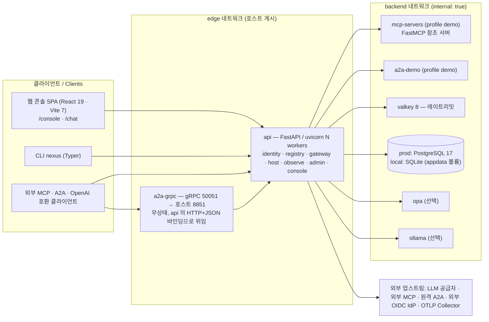

# 구현 프로젝트 심층 분석 보고서 / In-Depth Project Review

> 분석일 / Analysis Date: 2026-10-07 · 대상 / Target: `/Users/wise/Developer/wise-AgentNexus` (AgentNexus 0.1.0) · 분석 / Analyst: Claude
> 방법 / Method: wds-review depth-method Step 1–9. 관찰 사실만 기록, 근거는 파일 경로(+행). 부재 파일은 "확인 불가 — 파일 부재".
> 범위 밖 / Out of scope: 코드 수준 취약점 탐색은 별도 보안 리뷰 `.review/delegated/security-review.md`(2026-10-07 13:50 산출) 몫이다. 이 보고서 3장은 그 결과를 요약 인용(3.0)하고 정책·공급망·시크릿 관리만 보강한다.
> 시점 주의 / Snapshot note: 분석 시점에 7차(Epic 36~39)가 진행 중이었다 — `test/impl/36th`·`37th` 에는 `result.md` 가 없고, `38th` kind 클러스터(`agentnexus-e38-*`)는 실행 중이었다.

---

## 1. 프로젝트 개요 / Overview

### 1.1 목적·분류 (Purpose · Classification)

- **분류 / Class**: Platform (자체 호스팅 애플리케이션 플랫폼, self-hosted application platform) + CLI Tool.
- **목적 / Purpose**: 모델(LLM)·도구(MCP)·원격 에이전트(A2A) 호출을 하나의 AI Gateway 에서 정책·한도·가드·신원 전파·감사로 통제하는 에이전트 플랫폼 (`PRD.md:12-18`, `README.md:1-4`).
- **배포 형태 / Delivery**: docker compose(local/prod), Helm 차트(`deploy/helm/agentnexus`), 에어갭 번들(`nexus bundle export` — 컨테이너 이미지 `docker save` + 차트, `app/cli/nexus.py:627-648`). 즉 **SaaS 운영과 온프레미스 바이너리 배포 둘 다** 상정한다(FR-P02, NFR-D1 — `PRD.md:34,73`).
- **업종 오버레이 / Domain**: KSIC J (ICT·SaaS) — `COMPLIANCE.md:1-15`.

### 1.2 소프트웨어 스택 (Software Stack)

| 영역 | 구성 (분석 시점 실측 버전) | 근거 |
|---|---|---|
| 언어·런타임 | Python 3.12.15 (컨테이너, `requires-python >=3.12`) · Node 22 (빌드 전용) · TypeScript 5.9.3 | `pyproject.toml:5`, `Dockerfile:2,19`, api 컨테이너 `sys.version` |
| 백엔드 프레임워크 | FastAPI 0.142.2 · uvicorn 0.54.0 · Pydantic 2.13.5 · pydantic-settings 2.15.0 · Typer 0.27.2(CLI) | `pyproject.toml:7-26`, `uv.lock` |
| 데이터 | SQLAlchemy 2.1.3 · Alembic 1.20.0(마이그레이션 18개 `migrations/versions/0001~0018`) · local=SQLite · prod=PostgreSQL 17 (`psycopg` 3.3.6) | `docker-compose.prod.yml:18`, `.env.local:5`, `.env.prod:6` |
| 캐시·카운터 | Valkey 8 (`valkey/valkey:8-alpine`, 실행 버전 8.1.10) · 클라이언트 redis-py 8.1.0 | `compose/valkey.yml:5` |
| 프로토콜 | MCP(FastMCP 4.0.11 · mcp SDK 2.3.0, 사양 2025-11-25 + 2026-07-28 dual-era) · A2A(a2a-sdk 1.2.2, 1.0 기본 + 0.3 협상, JSON-RPC·HTTP+JSON·gRPC) · gRPC(grpcio 1.84.0) · OpenAI 호환 API | `app/core/config.py:5-8`, `test/impl/36th·37th/scenario.md` |
| 관측 | OpenTelemetry SDK 1.45.0 + OTLP/HTTP exporter · prometheus-client 0.26.0(multiprocess) · JSON 구조화 로그 | `app/core/logs.py:1-3`, `Dockerfile:44` |
| 정책 | 내장 + OPA 어댑터(`openpolicyagent/opa:1.4.2`, 선택) | `compose/opa.yml`, `policies/agentnexus.rego` |
| 프론트엔드 | React 19.3.0 · Vite 7.3.7 · Tailwind 4.3.3 · TanStack Query/Table/Virtual · @xyflow/react 12 · recharts 3 · pnpm 10.12.1 | `web/package.json`, `web/pnpm-lock.yaml` |
| 시험 | pytest 9.1.1(270 함수 / 35 파일) · Vitest 3.2.7(5 파일) · Playwright 1.55.0 + axe-core(23 spec) · k6 1.0.0(컨테이너) | `test/`, `web/src/test/`, `web/e2e/`, `deploy/k6/` |
| 배포 | Docker 다단계(dev·web-dev·web-build·e2e·runtime) · compose(local/prod) · Helm v2 차트 0.1.0 (`kubeVersion >=1.27`) | `Dockerfile`, `deploy/helm/agentnexus/Chart.yaml` |
| CI | GitHub Actions 1개 워크플로(`ci.yml`, preflight → `make test` → prod 이미지 빌드) | `.github/workflows/ci.yml:1-13` |

### 1.3 아키텍처 (Architecture)

패턴 관찰: **모듈형 모놀리스(modular monolith)** — 단일 FastAPI 앱이 `COMPONENTS` env 로 라우터를 선택 마운트한다(`app/main.py:1`, `app/core/config.py:10,84-87`). 레이어는 `app/api`(라우터) → `app/services`(도메인 로직·어댑터) → `app/core`(인증·키·로그·트레이싱) → `app/models.py`(ORM 61 클래스) 로 나뉜다. 외부 시스템은 env 로 붙는 어댑터(OIDC IdP·OPA·OpenAI 호환 업스트림·Valkey·OTLP)다(`PRD.md:83` D2).



- 진입점 / Entry points: `app/main.py`(api), `app/grpc_server.py`(a2a-grpc), `app/builtin/mcp_servers.py`·`app/builtin/a2a_agent.py`(데모), `app/cli/nexus.py`(CLI), `web/src/main.tsx`(SPA), `scripts/entrypoint.sh`(마이그레이션·시드 후 exec).
- 네트워크 분리: `docker-compose.yml:79-80` backend `internal: true`, Helm 은 NetworkPolicy 2종(`templates/networkpolicy.yaml`). 단 `a2a-grpc` 는 edge 에 호스트 포트를 연다(`docker-compose.yml:63,69`) — README 의 "api 가 유일한 진입점"(`README.md:37`) 기술과 다르다.
- 통신: REST/JSON-RPC/SSE(HTTP), gRPC(a2a-grpc → api 는 HTTP), DB 는 SQLAlchemy, 큐/MQ 없음(예약 작업은 DB 리스 기반 스케줄러 — `.env.example` `SCHEDULER_INTERVAL_S` 주석).

### 1.4 소스 트리 (관찰 사실만 / observed only)

```
wise-AgentNexus/
├── app/            83 .py, 23,729 행 — api/(16 라우터 모듈) · services/(37) · core/(11) · builtin/(데모) · cli/ · models.py · db.py · seed.py · grpc_server.py
├── web/            src/ 14,003 행(TS/TSX) · e2e/(Playwright 23 spec, package.json 만 — 잠금 파일 없음) · dist/(빌드 산출, git 무시)
├── migrations/     Alembic 0001~0018
├── deploy/         helm/agentnexus(Chart 0.1.0, templates 11 + ci values 3) · helm/check-rendered.py · k6/(3 스크립트)
├── compose/        valkey.yml · opa.yml · ollama.yml (두 모드에 자동 포함 — Makefile:20)
├── policies/       agentnexus.rego
├── test/           pytest 35 파일 · contract/openapi-paths.json · dev-env/ · impl/1st~38th
├── docs/           implementation-plan.md
├── .docs/          원본 PRD·UI 설계 PDF 2종(10MB) · .wds/ PDF 추출본 · .omc/ AI 도구 세션 상태
├── Dockerfile · docker-compose.yml · docker-compose.local.yml · docker-compose.prod.yml · Makefile
├── PRD.md · README.md · README.en.md · COMPLIANCE.md · pyproject.toml · uv.lock · alembic.ini
├── .env.example · .env.local · .env.prod · .gitignore · .dockerignore · .github/workflows/ci.yml
└── dist/agentnexus-0.1.0.tgz (helm package 산출, git 무시)
```

최상위 거버넌스 문서 / Top-level governance docs:

| 파일 | 상태 |
|---|---|
| LICENSE | 확인 불가 — 파일 부재 |
| NOTICE · THIRD_PARTY_LICENSES | 확인 불가 — 파일 부재 |
| SECURITY.md | 확인 불가 — 파일 부재 |
| CHANGELOG | 확인 불가 — 파일 부재 (PRD.md §12 변경 이력이 대신함) |
| CONTRIBUTING · CODE_OF_CONDUCT · CODEOWNERS | 확인 불가 — 파일 부재 |
| .github/dependabot.yml · renovate.json | 확인 불가 — 파일 부재 |
| README.md / README.en.md | 있음 (각 약 57KB, 한/영) |
| COMPLIANCE.md | 있음 (ict-saas, OWASP Agentic T1~T15, PIPA 매핑) |

---

## 2. 라이선스 분석 / License Analysis

조사 방법: Python 은 실행 중 local api 컨테이너에서 `importlib.metadata`(License-Expression·License·Classifier)로 115개 설치 패키지 전체를 읽었다. JS 는 호스트 `web/node_modules` 가 없어, 로컬에 이미 빌드돼 있던 `wise-agentnexus-local-web:latest`·`wise-agentnexus-local-e2e:latest` 이미지 안의 `node_modules/*/package.json` 을 `--network none --pull never` 일회성 컨테이너로 읽었다(266 패키지). 컨테이너 OS 패키지는 `wise-agentnexus-api:prod`(dpkg)·`postgres:17-alpine`(apk) 을 같은 방식으로 읽었다.

### 2.1 자체 라이선스 (Project License)

- `LICENSE` — 확인 불가 — 파일 부재.
- `pyproject.toml` 에 `license` 필드 없음(`pyproject.toml:1-29`). `web/package.json` 은 `"private": true` 이고 `license` 필드 없음. `deploy/helm/agentnexus/Chart.yaml` 에도 라이선스·maintainers 없음.
- 저작권 표기(copyright header) — 소스 파일·README 어디에도 없음(README 에 라이선스 절 없음).
- 판단: 명시 라이선스가 없으므로 법적으로는 "All rights reserved" 상태다. 자사 상용화에는 지장이 없으나, 고객 배포(에어갭 번들·Helm 차트)에는 EULA 또는 상용 라이선스 문서가 필요하고, 공개 저장소(`origin = github.com/WisemanLim/AgentNexus`)로 올릴 경우 공개 여부에 맞는 라이선스 결정이 선행돼야 한다. 저장소 공개 여부는 확인 불가(네트워크 미사용).

### 2.2 의존성 라이선스 목록 (Dependency Licenses)

#### (a) Python 직접 의존성 — 런타임 (`pyproject.toml:6-29`, `uv.lock` 고정 버전)

| 패키지 | 고정 버전 | 라이선스(메타데이터) | 위험 |
|---|---|---|---|
| fastapi | 0.142.2 | MIT | 🟢 |
| uvicorn[standard] | 0.54.0 | BSD-3-Clause (extras: httptools MIT · uvloop MIT/Apache-2.0 · watchfiles MIT · websockets BSD-3 · python-dotenv BSD-3) | 🟢 |
| pydantic / pydantic-settings | 2.13.5 / 2.15.0 | MIT / MIT | 🟢 |
| sqlalchemy / alembic | 2.1.3 / 1.20.0 | MIT / MIT | 🟢 |
| **psycopg[binary]** (psycopg + psycopg-binary) | 3.3.6 | **LGPL-3.0-only** | 🟡 |
| httpx | 0.28.1 | BSD-3-Clause | 🟢 |
| pyjwt[crypto] | 2.15.1 | MIT | 🟢 |
| cryptography | 50.0.2 | Apache-2.0 OR BSD-3-Clause | 🟢 |
| pyyaml | 6.0.3 | MIT | 🟢 |
| jsonschema | 4.26.0 | MIT | 🟢 |
| python-multipart | 0.0.32 | Apache-2.0 | 🟢 |
| redis (redis-py) | 8.1.0 | MIT | 🟢 |
| prometheus-client | 0.26.0 | Apache-2.0 AND BSD-2-Clause (NOTICE 파일 동봉) | 🟢 |
| opentelemetry-api / -sdk / -exporter-otlp-proto-http | 1.45.0 | Apache-2.0 | 🟢 |
| fastmcp (+ fastmcp-slim) | 4.0.11 | Apache-2.0 (fastmcp-slim 은 라이선스 파일 미동봉, 메타데이터만) | 🟢 |
| typer | 0.27.2 | MIT | 🟢 |
| grpcio | 1.84.0 | Apache-2.0 | 🟢 |
| a2a-sdk | 1.2.2 | Apache-2.0 (Author: Google LLC) | 🟢 |

dev 그룹(`pyproject.toml:32`, prod 이미지에는 미설치 — `uv sync --no-dev`, `Dockerfile:46`): pytest 9.1.1 MIT · ruff 0.16.10 MIT · openai 3.24.0 Apache-2.0 — 모두 🟢.

주요 전이 의존성 / notable transitive: mcp 2.3.0 MIT("Model Context Protocol a Series of LF Projects, LLC.") · **certifi 2026.7.22 MPL-2.0** 🟡 · protobuf 7.36.2 BSD-3 · googleapis-common-protos·google-auth·google-api-core Apache-2.0 · requests Apache-2.0(NOTICE 동봉) · authlib BSD-3 · joserfc BSD-3 · typing_extensions PSF-2.0 · email-validator Unlicense · aiologic·culsans ISC(라이선스 파일 미동봉) · keyring·jeepney MIT / SecretStorage BSD-3(py-key-value-aio 경유). 115개 중 GPL·AGPL·SSPL·BUSL **0건**. `uv.lock` 121항목 중 리눅스에 설치되지 않는 5개(pywin32·pywin32-ctypes·colorama·tzdata·httpx2-jsfetch)와 프로젝트 자신은 확인 불가 — 미설치 플랫폼 전용.

psycopg-binary 휠이 동봉하는 네이티브 라이브러리(관찰한 파일명): `libpq-…so.5.18`, `libssl…so.3`, `libcrypto…so.3`, **`libcrypto-…so.1.1.1k`**, `libkrb5`, `libgssapi_krb5`, `libldap`, `liblber`, `libsasl2`, `libcrypt`, `libkeyutils`, `libpcre2-8`, `libselinux`, `libcom_err`. 각 라이브러리의 개별 라이선스(PostgreSQL·OpenSSL·MIT krb5·OpenLDAP·LGPL-2.1 계열 등)는 로컬 메타데이터로 확인 불가 — 업스트림 확인 필요.

#### (b) JavaScript 직접 의존성 (`web/package.json`)

| 구분 | 패키지 | 해석 버전 | 라이선스 | 위험 |
|---|---|---|---|---|
| prod(번들 포함) | @tanstack/react-query · react-table · react-virtual | 5.104.1 · 8.21.3 · 3.14.13 | MIT | 🟢 |
| prod | @xyflow/react | 12.12.0 | MIT | 🟢 |
| prod | cmdk | 1.1.1 | MIT | 🟢 |
| prod | **pretendard** (폰트, `web/src/main.tsx:1` 로 번들 → `web/dist/_app/PretendardVariable-*.woff2`) | 1.3.9 | **OFL-1.1** | 🟡 |
| prod | react · react-dom | 19.3.0 | MIT | 🟢 |
| prod | react-router | 7.18.4 | MIT | 🟢 |
| prod | recharts | 3.10.1 | MIT | 🟢 |
| prod | yaml | 2.9.1 | ISC | 🟢 |
| dev | @tailwindcss/vite · tailwindcss | 4.3.3 | MIT | 🟢 |
| dev | @testing-library/* (jest-dom·react·user-event·dom) | 6.10.0 · 16.3.3 · 14.6.7 · 10.4.2 | MIT | 🟢 |
| dev | @types/node · @types/react · @types/react-dom | 22.20.5 · 19.3.0 · 19.3.0 | MIT | 🟢 |
| dev | @vitejs/plugin-react · vite · vitest · jsdom | 5.2.0 · 7.3.7 · 3.2.7 · 26.1.0 | MIT | 🟢 |
| dev | typescript | 5.9.3 | Apache-2.0 | 🟢 |
| e2e(`web/e2e/package.json`) | @playwright/test (+ playwright) | 1.55.0 | Apache-2.0 | 🟢 |
| e2e | **@axe-core/playwright · axe-core** | 4.10.2 · 4.10.3 | **MPL-2.0** | 🟡 (시험 전용) |

web 이미지 전체 266 패키지 분포: MIT 220 · ISC 26 · Apache-2.0 7 · BSD-3 3 · **MPL-2.0 3**(lightningcss 1.32.0 + 플랫폼 바이너리 2 — Tailwind 빌드 도구) · BSD-2 2 · MIT-0 1 · **CC-BY-4.0 1**(caniuse-lite — browserslist 빌드 데이터) · OFL-1.1 1(pretendard) · 0BSD 1(tslib) · "MIT AND ISC" 1. GPL·AGPL **0건**.

#### (c) 컨테이너 이미지 (배포 경로별)

| 이미지 | 용도 | 라이선스 관찰 | 위험 |
|---|---|---|---|
| `wise-agentnexus-api:prod` (base `python:3.12-slim`, Debian 13 trixie) | prod·Helm·에어갭 번들 기본 포함(`app/cli/nexus.py:627`) | dpkg 87 패키지 중 76개 copyright 파일에 GPL 문구(bash·coreutils·dash·grep·gzip·sed·tar·libc6 포함). Python PSF · uv MIT/Apache-2.0 | 🟠 (배포 시 GPL 소스 제공 의무) |
| `postgres:17-alpine` (PostgreSQL 17.10) | prod·Helm 내장 DB·에어갭 기본 포함 | PostgreSQL License + apk 45개 중 GPL-2.0-only 8 · GPL-3.0-or-later 3 · GPL-2.0-or-later AND LGPL-2.1-or-later 2 | 🟠 (배포 시) |
| `valkey/valkey:8-alpine` (8.1.10) | 레이트리밋, 에어갭 기본 포함 | Valkey 본체 BSD-3-Clause(업스트림 공표, 라벨 `org.opencontainers.image.source=github.com/valkey-io/valkey`) + Alpine 베이스 | 🟢 본체 / 🟠 베이스 OS |
| `openpolicyagent/opa:1.4.2` | 선택 | Apache-2.0(업스트림 공표, 로컬 라이선스 파일 미확인) | 🟢 |
| `ollama/ollama:0.31.1` + 모델 가중치(`qwen2.5:7b`) | 선택(에어갭 로컬 LLM) | Ollama MIT(업스트림 공표). 모델 가중치 라이선스 확인 불가 — 로컬 근거 없음 | 🔵 별도 확인 |
| `mcr.microsoft.com/playwright:v1.55.0-noble` · `node:22-alpine` | 시험·빌드 전용(배포 안 함) | Apache-2.0 / MIT + OS | 🟢 |

#### (d) 시험 전용 인프라 (Test-only infra — 제품에 포함·배포되지 않음)

| 구성 | 사용처 | 라이선스(업스트림 공표, 로컬 미검증) | 비고 |
|---|---|---|---|
| kind (`kindest/node:v1.36.1`) | 31st·34th·38th 클러스터 시험 | Apache-2.0 | |
| Calico v3.30.3 | 34th·38th NetworkPolicy 집행 | Apache-2.0 | 고정 태그 |
| ingress-nginx (`main` 브랜치 매니페스트) | 34th·38th | Apache-2.0 | 버전 미고정 (`test/impl/34th/cluster-kind.sh:27`) |
| cert-manager (`releases/latest`) | 38th TLS | Apache-2.0 | 버전 미고정 (`test/impl/38th/cluster-ha.sh:73`) |
| metrics-server (`releases/latest`) | 34th HPA | Apache-2.0 | 버전 미고정 (`test/impl/34th/cluster-kind.sh:28`) |
| nfs-ganesha external provisioner (`master`) | 38th RWX | Apache-2.0 | 버전 미고정 (`test/impl/38th/cluster-ha.sh:107`) |
| **grafana/k6:1.0.0** | NFR 부하·장애 주입 (`deploy/k6/*.js`) | **AGPL-3.0** | 🔴 등급이지만 외부 도구로 컨테이너 실행만 — 제품 미포함·미배포·미수정, 의무 미발생 |

### 2.3 위험도 분류표 (License Risk Classification)

| 색 | 분류 | 해당 (제품 경로) | 해당 (시험·빌드 전용) |
|---|---|---|---|
| 🟢 | Permissive (MIT·BSD·Apache-2.0·ISC·PSF·Unlicense·0BSD·MIT-0) | Python 런타임 대부분, 콘솔 번들 JS 전부(폰트 제외), Valkey·OPA·Ollama 본체 | vite·vitest·typescript·Playwright·kind·Calico 등 |
| 🟡 | Weak copyleft / 조건부 고지 (LGPL·MPL·OFL·CC-BY) | **psycopg·psycopg-binary (LGPL-3.0-only, 직접 의존)** · certifi (MPL-2.0, 전이) · **pretendard (OFL-1.1, 번들 폰트)** | lightningcss (MPL-2.0) · caniuse-lite (CC-BY-4.0) · axe-core·@axe-core/playwright (MPL-2.0) |
| 🟠 | Strong copyleft (GPL-2.0/3.0) | 배포 컨테이너 이미지의 **OS 패키지**(Debian·Alpine) — 에어갭 번들·Helm 이미지 배포 시 | — |
| 🔴 | Network copyleft · 상용비호환 (AGPL-3.0·SSPL·BUSL·Commons Clause) | **없음** — Redis 7.4(RSALv2/SSPLv1) 는 Valkey 로 교체됨(`COMPLIANCE.md:65`, PRD D6), Grafana(AGPL) 는 기본 설치 제외 정책(`app/api/setup.py:345`) | grafana/k6 (AGPL-3.0, 외부 도구) |

### 2.4 호환성 분석 (Compatibility)

- **GPL + Apache-2.0 혼합**: 제품 코드 경로(Python 런타임·콘솔 번들)에 GPL 계열 라이브러리가 없다 → 링크 기반 호환성 충돌 없음. GPL 은 컨테이너 OS 패키지에만 있고, 이는 별개 프로그램의 집합(aggregate) 배포라 AgentNexus 코드로 전파되지 않는다. 다만 바이너리 배포자로서 GPL §3(대응 소스 제공 또는 서면 제안) 의무는 남는다.
- **AGPL 존재 여부(SaaS 트리거)**: 제품 런타임 0건. SaaS 운영 시 소스 공개 의무가 트리거되지 않는다. k6 는 시험 도구라 무관.
- **LGPL-3.0 (psycopg)**: Python import(동적 로딩) + 미수정 사용. 의무 — 라이선스 원문·저작권 고지 보존, 사용자가 라이브러리를 교체할 수 있어야 함(LGPL-3 §4; 컨테이너 안 site-packages 교체가 가능하므로 구조적 장애는 없음), 배포 시 대응 소스 접근 경로 제공. 라이선스 원문은 dist-info 에 동봉돼 있음(`psycopg-3.3.6.dist-info/licenses/LICENSE.txt`). PRD NFR-LIC1 "허용적 라이선스 우선"(`PRD.md:73`)에 대한 예외로 문서화돼 있지 않다.
- **MPL-2.0 (certifi·lightningcss·axe-core)**: 파일 단위 copyleft. 미수정 사용 → 고지만 필요. lightningcss·axe-core 는 배포물에 포함되지 않는다(빌드·시험 단계).
- **OFL-1.1 (Pretendard)**: 폰트를 웹 번들로 재배포한다. OFL 은 재배포 시 저작권 고지와 라이선스 원문을 함께 둘 것을 요구한다. 관찰: `web/dist/` 에 OFL 원문·저작권 고지 없음.
- **번들 고지 보존**: `web/dist/_app/*.js` 28개 파일 어디에도 `@license`·`Copyright` 주석이 없다(Vite 기본 빌드로 제거됨, `web/vite.config.ts` 에 legalComments 설정 없음). MIT·ISC 는 "모든 사본에 고지 포함"을 요구하므로 별도 고지 파일이 필요하다.
- **Apache-2.0 NOTICE 전파**: 설치 패키지 중 NOTICE 를 동봉한 것은 prometheus_client·requests 2개. 제품 배포물에 이를 모은 NOTICE 파일이 없다.

### 2.5 상용화 의무 이행 사항 (Obligation Checklist)

| # | 의무 | 상태 | 근거 |
|---|---|---|---|
| 1 | 자체 LICENSE/EULA 명시 | ❌ 미이행 | LICENSE 부재, pyproject·package.json·Chart 라이선스 필드 없음 |
| 2 | 제3자 고지 파일(NOTICE / THIRD_PARTY_LICENSES) | ❌ 미이행 | 파일 부재 |
| 3 | 콘솔 번들 내 MIT/ISC 저작권 고지 보존 | ❌ 미이행 | `web/dist/_app/*.js` 라이선스 주석 0건 |
| 4 | Pretendard OFL-1.1 원문 동봉 | ❌ 미이행 | `web/dist/` 에 OFL 텍스트 없음 |
| 5 | LGPL-3.0 psycopg 고지·교체 가능성·소스 경로 | △ 부분 | dist-info 원문 동봉, 제품 수준 고지·소스 경로 안내 없음 |
| 6 | 배포 이미지 GPL OS 패키지 대응 소스 제공(에어갭 번들) | ❌ 미정의 | `nexus bundle export` 가 이미지만 `docker save`(`app/cli/nexus.py:646-648`), 소스 제공·서면 제안 절차 없음 |
| 7 | 제품 내 OSS 고지 메뉴 | △ 부분 | 콘솔 SBOM 화면(`/console/catalog/sbom`)이 Python 패키지 라이선스 이름·위험도를 표시 — 원문·JS·OS 패키지는 없음 |
| 8 | 상용비호환 라이선스 배제 | ✅ 이행 | Redis → Valkey(D6), Grafana 기본 제외(`app/api/setup.py:345`) |
| 9 | 라이선스 정책 문서(허용·금지 목록) | △ 부분 | PRD NFR-LIC1 한 줄 + 앱 내 위험 분류 규칙(`app/services/registry.py:511-527`) |

---

## 3. 보안 분석 / Security (정책·공급망·시크릿)

### 3.0 위임 보안 리뷰 요약 (Delegated Security Review — 인용)

출처: `.review/delegated/security-review.md` (정적 읽기, `/security-review` 미가용 → security-reviewer 서브에이전트 폴백). 이 보고서는 해당 결과를 재검증하지 않고 건수·등급만 인용한다.

| 심각도 | 건수 | 항목(요지) |
|---|---|---|
| Critical | 0 | — |
| High | 3 | SEC-01 외부 IdP JWT 검증이 토큰 헤더의 `alg` 사용(`app/core/auth.py:140-148`) · SEC-02 OpenAPI fetch 등 서버측 URL 요청에 사설 IP·메타데이터 차단 없음(SSRF, `app/api/mcp.py:533-551` 외 4곳) · SEC-03 로그인 실패 횟수 제한·잠금 없음(`app/api/idp.py:98-103,229-260`) |
| Medium | 6 | SEC-04 푸시 URL SSRF · SEC-05 prod 에서도 localhost redirect_uri 허용 · SEC-06 로그인 폼 CSRF 토큰 없음 · SEC-07 Access Token subject 임의 지정 · SEC-08 LIKE 와일드카드 미이스케이프 · SEC-09 Discovery `jwks_uri` 도메인 미검증 |
| Low | 3 | SEC-10 scrypt n=2^14 · SEC-11 app_env 오설정 시 password grant · SEC-12 client_id 별 redirect_uri 미등록 |

위임 리뷰 종합: **MEDIUM**. 상용 릴리스 전 High 3건은 수정·회귀 시험이 필요하다(Epic 39 "품질 검토 반영" 범위와 일치 — `docs/implementation-plan.md:46`). 아래 3.1~3.3 은 그 결과에 없는 정책·공급망·시크릿 관리 관점이다.

### 3.1 정책·취약점 관리 (Policy · Vulnerability Management)

| 항목 | 상태 | 근거 |
|---|---|---|
| SECURITY.md (신고 채널·지원 버전·SLA) | 확인 불가 — 파일 부재 | |
| 자동 의존성 갱신 (Dependabot/Renovate/Snyk) | 확인 불가 — 파일 부재 | `.github/` 에는 `workflows/ci.yml` 만 |
| CI 의존성 감사 (pip-audit · pnpm audit · osv-scanner · trivy) | 없음 | `ci.yml:9-13` 은 preflight·pytest·이미지 빌드만. 저장소 전체에서 audit 도구 참조 0건 |
| 빌드 SBOM (CycloneDX/SPDX, syft 등) | 없음 | 빌드·CI 단계 산출 없음 |
| 런타임 SBOM (제품 기능) | 있음 — 부분 | `GET /v1/catalog/sbom` CycloneDX 1.6: 실행 중 Python 배포판 + 승인된 카탈로그 항목(`app/services/registry.py:539-569`). JS 번들·OS 패키지·컨테이너 이미지는 포함되지 않음 |
| 이미지 서명 | 선택 기능만 | `COSIGN_PUBLIC_KEY` 는 업그레이드 계획 화면의 검증 준비 표시용(`.env.example` 주석, README:246). 빌드 파이프라인에 서명 단계 없음 |
| 저장소 보호 (브랜치 보호·리뷰 강제) | 확인 불가 | 원격 설정 비조회. 로컬 git 은 커밋 1개(README.md 만 추적) |

### 3.2 알려진 위험 (Known Risks — 공급망)

| # | 관찰 | 근거 | 영향 |
|---|---|---|---|
| S-1 | psycopg-binary 휠이 **OpenSSL 1.1.1k**(`libcrypto-…so.1.1.1k`)를 동봉 — OpenSSL 1.1.1 계열은 2023-09 지원 종료(EOL) | api 컨테이너 `psycopg_binary.libs/` 파일 목록 | EOL 암호 라이브러리가 이미지에 존재. 실제 로딩 경로(krb5/ldap 의존 여부)는 확인 불가 — 업스트림 확인 필요 |
| S-2 | uv 설치 버전 미고정 | `Dockerfile:5` `pip install --no-cache-dir uv` | 빌드 재현성·공급망(빌드 도구 변경) |
| S-3 | 베이스 이미지 digest 미고정(태그만) | `Dockerfile:2,19,35`, `docker-compose.prod.yml:18`, `compose/valkey.yml:5`, Helm `values.yaml:83,93` | 같은 태그의 내용 변동 |
| S-4 | `uv sync` 에 `--locked`/`--frozen` 없음 | `Dockerfile:13,46` (`COPY pyproject.toml uv.lock* ./` 로 잠금 파일도 선택적) | pyproject 와 잠금이 어긋나면 빌드 중 재해석 가능 |
| S-5 | e2e 의존성 잠금 파일 없음 → `npm install` 해석 결과가 `playwright-core 1.63.0`(이미지 안), `@playwright/test`·Playwright 이미지는 1.55.0 | `web/e2e/package.json:6`, `Dockerfile:35-38`, e2e 이미지 `node_modules` | 시험 환경 재현성. 제품 배포물 영향 없음 |
| S-6 | 시험 스크립트가 `main`·`master`·`latest` 매니페스트를 내려받아 적용 | `test/impl/34th/cluster-kind.sh:27-28`, `test/impl/38th/cluster-ha.sh:68,73,107` | 시험 재현성·공급망(시험 클러스터 한정) |
| S-7 | pyproject 의존성이 하한만 지정(`>=`), 상한 없음 | `pyproject.toml:7-28` | 잠금 갱신 시 fastmcp·a2a-sdk·mcp 메이저 변경 유입 — 사양 변동이 큰 영역(PRD §8 리스크 1) |
| S-8 | CI 워크플로가 액션을 태그로 참조(`actions/checkout@v4`), `permissions:` 블록 없음 | `.github/workflows/ci.yml:9` | GitHub 기본 토큰 권한 사용 |
| S-9 | 런타임 이미지에 비배포 자료 포함 — `.docs/`(원본 기획 PDF 2종), `.omc/`(AI 도구 세션·상태), `.wds/`, `.pytest_cache/`, `.ruff_cache/`, `test/`, `dist/`, `.github/`, `.DS_Store` | `wise-agentnexus-api:prod` 의 `/app` 목록 · `.dockerignore`(이 항목들 미제외) · `Dockerfile:47` `COPY . .` | 내부 문서·작업 기록이 고객 배포 이미지(에어갭 번들)로 유출 |

하드코딩 시크릿 점검(패턴: `sk-…`, `AKIA…`, `ghp_…`, `xox?-`, `AIza…`, PEM 개인키): 저장소(node_modules·dist·.git·logs 제외) 에서 `test/test_gateway_policy.py:161` 의 시험용 가짜 토큰 1건 외 0건.

### 3.3 보안 아키텍처 — 인증·시크릿 관리 (Auth · Secret Management)

- **인증/인가**: 내장 OIDC IdP(RS256 JWKS, Code+PKCE·Device·Client Credentials·Refresh 회전), RBAC 6역할, PAT, RFC 8693 토큰 교환, TOTP MFA, 외부 IdP SSO 브로커(`README.md:14`, `COMPLIANCE.md:137`). 세부 구현 검증은 위임 보안 리뷰 몫.
- **시크릿 주입 경로**: env 파일(`.env.prod`) → compose `env_file`; Helm 은 `existingSecret` 또는 차트 생성 Secret(`lookup` 으로 업그레이드 간 유지, `helm.sh/resource-policy: keep` — `templates/secret.yaml:4-18,25`).
- **CHANGE_ME 처리**: 서명 키·암호화 키·OTLP 토큰·데모 시크릿은 `CHANGE_ME` 를 "미설정"으로 보고 `data_dir/keys` 에 0600 파일로 자동 생성(`app/core/keys.py:24-46,74-79`, `app/seed.py:42,187`). 부트스트랩 admin 은 CHANGE_ME 면 생성하지 않음(`app/seed.py:41-44`). **DB 비밀번호는 예외** — `DB_PASSWORD=CHANGE_ME` 가 그대로 PostgreSQL 비밀번호가 된다(`docker-compose.prod.yml:21`). `make deploy` 만 CHANGE_ME 를 거부하고(`Makefile:93`) `make prod-all`·`prod-build` 은 경고 없이 기동한다(preflight 는 WARN 만, `Makefile:43`). 시험 기록상 prod 리허설은 이 상태로 수행됐다.
- **저장 시크릿**: 시크릿 저장소는 Fernet 암호화(`app/services/secrets.py:1-26`), 항목별 `rotated_at` 은 있으나 **마스터 키(ENCRYPTION_KEY)·서명 키 회전 수단은 없음**(단일 Fernet 키·단일 JWKS 키, `app/core/keys.py` — MultiFernet·키 목록 없음).
- **외부 시크릿 관리자**: Vault·AWS SSM/Secrets Manager·KMS·External Secrets 연동 코드·문서 0건. `.env.prod` 주석은 "Secret Manager/Vault/CI 시크릿으로 주입"을 권고만 한다(`.env.prod:2`).
- **`nexus install`**: `.env.example` 의 CHANGE_ME 를 난수로 채워 0600 으로 쓰고 값을 출력하지 않는다(`app/cli/nexus.py:275-323`) — 운영 env 생성 경로로는 적절.

---

## 4. 커뮤니티·유지보수 / Community · Maintenance

### 4.1 활성도 (Activity)

| 지표 | 관찰 | 비고 |
|---|---|---|
| 커밋 | 1개 — `509f52f Initial commit` (2026-10-06 16:22 +0900) | 추적 파일은 `README.md` 1개 (`git ls-files`) |
| 작업 트리 | `app/`·`web/`·`deploy/`·`test/`·`.github/` 등 사실상 전체가 untracked, `README.md` 수정됨 | `git status --short` |
| 기여자 | 1명 (B.C. Wiseman Lim) | `git log --format='%an'` |
| 브랜치·태그·릴리스 | `main` 1개, 태그 0, 릴리스 0 | |
| 원격 | `origin = https://github.com/WisemanLim/AgentNexus.git` | 이슈·PR·공개 여부 확인 불가(네트워크 미사용) |
| 시험 결과의 커밋 연결 | 모든 `test/impl/*/result.md` 가 "커밋: — (git 저장소 아님)" 으로 기록 | `.git` 은 존재 — 결과와 형상이 연결되지 않음 |
| CI 실행 이력 | 워크플로 파일이 untracked → 원격 CI 가 한 번도 돌지 않음 | `.github/workflows/ci.yml` |

판정: **신규/내부 — 커뮤니티 지표 해당 없음.** 단일 작성자·단일 커밋이라 버스 팩터(bus factor) 1, 코드 리뷰·변경 이력 증적 없음.

### 4.2 거버넌스 (Governance)

- CONTRIBUTING·CODE_OF_CONDUCT·CODEOWNERS·PR 템플릿 — 확인 불가 — 파일 부재.
- 결정 기록: `PRD.md` §4 D1~D16(아키텍처 결정)·§12 변경 이력이 ADR·CHANGELOG 역할을 한다 — 결정마다 일자·사유가 있다.
- 구현 계획·차수 기록: `docs/implementation-plan.md`(Epic 39개), `test/impl/1st~38th`(scenario·result·스크립트). 원본 로그는 git 무시 대상(`.gitignore:25` `test/**/logs/`) — result.md 가 가리키는 로그는 저장소에 남지 않는다.

### 4.3 스폰서십·LTS (의존 OSS 성숙도로 대체 평가)

| 의존 OSS | 주도 주체(패키지 메타데이터) | 관찰 |
|---|---|---|
| FastAPI · Typer | fastapi 조직 (Sebastián Ramírez) | 0.x 버전 체계 유지 |
| SQLAlchemy · Alembic | Mike Bayer / sqlalchemy.org | 2.x 안정 계열 |
| Pydantic | pydantic 조직(다수 메인테이너) | 2.x |
| OpenTelemetry Python | OpenTelemetry Authors (CNCF 메일링 리스트) | exporter 일부 0.66b0(beta) |
| mcp (Python SDK) | "Model Context Protocol a Series of LF Projects, LLC." | 사양 버전 2025-11-25·2026-07-28 공존 — 변동 큼 |
| a2a-sdk | Google LLC · a2a-protocol.org (proto 패키지 `lf.a2a.v1`) | 0.3 → 1.0 전환기 |
| fastmcp | Jeremiah Lowin, Nate Nowack (개인/기업 주도) | 4.x 메이저 — 메이저 변경 빈번 |
| grpcio · cryptography · prometheus-client | gRPC Authors · PyCA · Prometheus Authors | 성숙 |
| psycopg | Daniele Varrazzo (개인 주도) | 사실상 표준 PG 드라이버 |
| Valkey | valkey-io (이미지 라벨) | Redis 포크, BSD-3 |

릴리스 케이던스(자체): 모든 버전 표기가 `0.1.0`(`pyproject.toml:3`, `app/core/config.py:4`, `Chart.yaml:5-6`, `web/package.json:4`) — SemVer 릴리스 이력·LTS 정책 없음.

### 4.4 문서 품질 (Documentation)

- 강점: README.md 473행 · README.en.md 472행(구성요소·실행 모델·엔드포인트·환경 변수·시험 표·트러블슈팅 37건·알려진 제한), COMPLIANCE 매핑, OpenAPI `/openapi.json` + 계약 스냅샷(`test/contract/openapi-paths.json`), k6 실행 방법(`deploy/k6/README.md`).
- 공백: 운영 런북(장애 대응·키 회전·DB 업그레이드 절차) 별도 문서 없음, 업그레이드/마이그레이션 가이드는 콘솔 기능(SCR-L04) 설명만.
- 현행화 차이(분석 시점): 아래 5.6 의 문서 드리프트 참조.

---

## 5. 상용화 아키텍처 적합성 / Commercial Architecture Fitness

### 5.1 확장성·설정 주입 (Scalability · 12-factor)

| 12-factor 항목 | 관찰 | 판정 |
|---|---|---|
| Config | pydantic-settings 로 env 주입(`app/core/config.py:13-90`), env 파일은 local/prod 2종 | ✅ |
| Backing services | DB·Valkey·OPA·OTLP·IdP 를 URL 로 연결 | ✅ |
| Build/Release/Run | Docker 다단계, runtime 스테이지 `--no-dev`, 비루트 uid 10001(`Dockerfile:43-52`) | ✅ (이미지 내용물은 S-9) |
| Processes (무상태) | api 는 다중 워커·다중 복제 가능하나 `data_dir`(키 파일·audit-archive·백업·워크로드 시크릿)이 파일 상태 — 복제 > 1 이면 RWX 필요(`values.yaml:39-45`, PRD D9) | △ |
| Port binding · Concurrency | uvicorn `--workers ${UVICORN_WORKERS}`, Helm HPA 2~6·PDB(`values.yaml:29-37`) | ✅ |
| Disposability | 진입점에서 마이그레이션 후 exec(`scripts/entrypoint.sh`), Helm 은 initContainer + PG advisory lock | ✅ |
| Dev/prod parity | local=SQLite / prod=PostgreSQL — `make test-pg` 로 PG 회귀(`Makefile:63-68`), 35th 게이트 SQLite 263+1 / PG 264 통과 | △ (CI 는 SQLite 만) |
| Logs | stdout JSON + PII 마스킹(`app/core/logs.py`) | ✅ |
| Admin processes | `make db-*`, `nexus` CLI | ✅ |
| 멀티테넌시 | 팀 단위 애플리케이션 필터(DB RLS 아님) — `COMPLIANCE.md:62` | △ (SaaS 다중 고객 격리에는 부족) |

### 5.2 운영 (Operations)

- **헬스**: `/health` 하나가 DB ping 포함, 실패 시 503(`app/main.py:186-195`). Helm readiness·liveness 모두 `/health`(`templates/api.yaml:52-61`) → DB 일시 장애가 liveness 실패로 이어져 api 파드 재시작 연쇄 가능(liveness 는 `failureThreshold: 6`·20초 주기라 약 2분 유예).
- **메트릭·추적**: Prometheus multiprocess(`Dockerfile:44`, `scripts/entrypoint.sh:4-6`), ServiceMonitor·PrometheusRule 선택(`values.yaml:130-139`), OTel 스팬 + 외부 OTLP 내보내기, 내장 trace 저장소. SLO·오류 예산(35th).
- **고가용성**: PostgreSQL·Valkey 단일 인스턴스(`README.md` 알려진 제한) — 25th 장애 주입에서 DB 재시작 중 99.41%. Helm 은 외부 관리형 DB(`database.url`) 를 지원.
- **K8s 준비도**: 비루트·`readOnlyRootFilesystem`·`drop: [ALL]`·seccomp RuntimeDefault(`values.yaml:146-155`), NetworkPolicy(ingress 만, egress 제한 없음), `--proxy-headers --forwarded-allow-ips "*"`(`templates/api.yaml:43`). kind 실제 설치 18/18(31st)·다중 노드+Calico 21/21(34th).
- **compose ↔ Helm 차이**: `a2a-grpc` 서비스는 compose 에만 있고 Helm 차트에 없음(`test/impl/37th/scenario.md` 환경 가정 마지막 줄, `deploy/helm` 에 grpc 참조 0건). gRPC 수신은 평문(`app/services/a2a_grpc.py:251` `add_insecure_port`) — TLS 는 앞단 종료 전제.
- **prod 기본값에 데모 활성**: `.env.prod:49` `COMPOSE_PROFILES=demo`, Helm `values.yaml:104` `demo.enabled: true` → 참조 MCP 서버(가상 Jira 등)·데모 A2A 가 운영 기본 설치에 포함된다(에어갭 values 는 끔).

### 5.3 테스트·품질 (Testing · Quality)

| 층 | 규모 | 근거 |
|---|---|---|
| unit/integration (pytest) | 35 파일·270 시험 함수, SQLite + PostgreSQL 양쪽 | `test/`, `Makefile:61-68` |
| 계약 | OpenAPI 경로 스냅샷 | `test/test_contract.py`, `test/contract/openapi-paths.json` |
| 프론트 단위 (Vitest) | 5 파일(35th 게이트 27건) | `web/src/test/` |
| e2e·접근성 (Playwright + axe) | 23 spec(35th 게이트 77건) | `web/e2e/` |
| 성능·장애 | k6 3 스크립트, 장애 주입 4종 | `deploy/k6/`, `test/impl/25th` |
| 클러스터 | kind 설치·다중 노드·HA(진행 중) | `test/impl/31st·34th·38th` |
| 커버리지 | 확인 불가 — 측정 설정 없음 | pyproject·vite 설정에 coverage 없음 |
| 정적 분석 | ruff(설정 `pyproject.toml:40-41`, 차수 로그에서 실행), TS `tsc --noEmit`(`web/package.json:8`). Python 타입 검사(mypy/pyright) 없음 | |
| CI 자동화 | `make test`(SQLite pytest)·prod 이미지 빌드만. ruff·Vitest·PG·Playwright·helm-check 는 CI 밖(수동·차수 게이트) | `.github/workflows/ci.yml:10-13` |

### 5.4 Copyleft 격리 가능성 (Copyleft Isolation)

- 제품 코드에 Strong Copyleft 모듈 없음 → 격리 대상 없음.
- psycopg(LGPL) 는 DB 어댑터 층(SQLAlchemy dialect)에만 쓰이므로, 필요 시 다른 드라이버(pg8000 BSD-3 등)로 교체 가능한 위치다 — 교체 필요성은 낮고 고지로 충분.
- AGPL 도구(Grafana·k6)는 이미 "외부 연동만" 정책으로 격리돼 있다(`app/api/setup.py:345`).

### 5.5 의존성 잠금·재현 빌드 (Lockfiles · Reproducibility)

| 대상 | 잠금 | 관찰 |
|---|---|---|
| Python | ✅ `uv.lock` (revision 5, 121 항목, 해시 포함) | Dockerfile 에서 `--locked` 미사용(S-4) |
| Web 콘솔 | ✅ `web/pnpm-lock.yaml` (lockfileVersion 9.0) | 이미지 빌드 `--frozen-lockfile`(`Dockerfile:24`), `make web-lock` 으로 갱신 |
| e2e | ❌ 없음 | S-5 |
| 빌드 도구 | △ pnpm 고정(10.12.1), uv 미고정(S-2) | |
| 베이스 이미지 | △ 태그 고정, digest 미고정(S-3) | |

### 5.6 wise-vibe 표준 점검 (wise-vibe Standard Checks)

| # | 점검 | 결과 | 근거 |
|---|---|---|---|
| W-1 | docker compose 전용 (호스트 프로세스 관리자·Procfile·ecosystem 파일 없음) | ✅ 적합 | Procfile·ecosystem.config·supervisord·pm2·systemd unit 0건(전체 탐색). 수명주기 타겟 전부 `docker compose`(`Makefile:21-23,47-58`). `bin/nexus` 는 CLI 래퍼(프로세스 관리자 아님) |
| W-2 | local/prod 두 모드만 (.env.dev·.env.staging·dev/staging compose 없음) | ✅ 적합 | env 파일은 `.env.example`·`.env.local`·`.env.prod` 뿐, compose 는 `docker-compose{,.local,.prod}.yml` + `compose/*.yml`(두 모드 공통 확장). `Makefile:18` `MODES := local prod` |
| W-3 | `.env.prod` 비커밋 · 저장소에 CHANGE_ME 외 실값 없음 | ✅ 적합 | `git check-ignore` → `.gitignore:3` `.env.*` 매치. `git ls-files` = README.md 만. `.env.prod` 시크릿 8개(DB_PASSWORD·DATABASE_URL 내 비밀번호·BOOTSTRAP_ADMIN_PASSWORD·SIGNING_KEY_PEM·ENCRYPTION_KEY·OTLP_INGEST_TOKEN·METRICS_TOKEN·A2A_DEMO_CLIENT_SECRET) 모두 `CHANGE_ME`. `.env.local` 은 의도적 커밋 대상(`.gitignore:7` `!.env.local`)이며 시크릿 값 전부 공란 |
| W-3a | (부가) `.env.example` ↔ `.env.prod` 정합 | ⚠️ 차이 | `API_PORT` 8000(`.env.example:4`) vs 8800(`.env.prod:5`), `PUBLIC_BASE_URL` 동일 차이, `A2A_DEMO_CLIENT_SECRET` 공란 vs CHANGE_ME. compose 기본값도 8000(`docker-compose.yml:10`) — README 는 8800 기준(`README.md:37,240`). CI 는 `.env.example` 을 `.env.prod` 로 복사(`ci.yml:10`) |
| W-4 | prod DB 엔진 일치 (.env.prod / docker-compose.prod.yml / Makefile DB_ENGINE) | ✅ 일치 (postgres) | `.env.prod:6` `DB_ENGINE=postgres` · `docker-compose.prod.yml:18` `postgres:17-alpine` · `Makefile:9` `DB_ENGINE := postgres` · `.env.example:5` postgres · Helm `values.yaml:83` 17-alpine |
| W-5 | `test/dev-env/result.md` 존재·판정 | ✅ 존재 · PASS 8/8 (2026-10-06) / ⚠️ 낡음 | 결과가 `redis` 기동·포트 8000 기준이며, 이후 Valkey 교체(D6)·API_PORT 8800 변경 뒤 재실행 기록 없음. "git 저장소 아님" 기재 |
| W-6 | `test/impl/<Nth>/result.md` 존재·최신 판정 | ✅ 1st~35th 전부 존재·전부 PASS. 최신 확정 판정 = **35th PASS** (14/14 + 6차 게이트) / ⚠️ 36th·37th `result.md` 없음, 38th 진행 중 | 36th: scenario + pytest r1(1 실패)·r2(50 통과), prod 스모크 로그 없음. 37th: scenario + pytest r1(1 실패)·r2(41 통과) + local-smoke 4줄, prod 스모크 로그 없음. 38th: `cluster-ha-r1.log` H38-01~05 PASS 까지 |

문서 드리프트(분석 시점, 7차 진행 중이라 미반영으로 보임):

| 문서 | 기재 | 실제 |
|---|---|---|
| `README.md:472` / `README.en.md:471` | "gRPC·HTTP+JSON 바인딩은 범위 밖(JSONRPC 만)" | `app/services/a2a_rest.py`·`a2a_grpc.py`·`app/grpc_server.py` 구현, `docker-compose.yml:60-74` `a2a-grpc` 서비스 |
| `README.md:35-45` 서비스 표 · 환경 변수 표 | `a2a-grpc`·`A2A_GRPC_PORT`·`A2A_GRPC_PUBLIC_URL` 없음(README 내 `A2A_GRPC` 0건) | compose·`.env.*` 에 존재 |
| `README.md:37` | api 가 "유일한 진입점" | a2a-grpc 도 호스트 포트 게시(`docker-compose.yml:63`) |
| `README.md:459` / `README.en.md:458` · `PRD.md:139,205` | "35/35 DONE" | 계획표는 Epic 39개(`docs/implementation-plan.md:43-46`) |
| `docs/implementation-plan.md:43-44` | Epic 36·37 TODO | 코드·시험 존재 |
| `PRD.md:209` | 남은 후보에 "A2A gRPC·HTTP+JSON 바인딩" | D16 으로 착수·구현 |

---

## 6. 법적·컴플라이언스 / Legal · Compliance (ISO/IEC 5230 · OpenChain)

### 6.1 OpenChain 현황표

| 단계 | 상태 | 근거 |
|---|---|---|
| [식별] Identify | △ 부분 | 잠금 파일(uv.lock·pnpm-lock) 존재, 런타임 SBOM 은 Python + 카탈로그만(`app/services/registry.py:539-569`). JS·OS·이미지 목록 없음, e2e 잠금 없음 |
| [소스검사] Scan | ❌ 없음 | 라이선스 스캐너(ScanCode·ORT·FOSSA 등)·CI 단계 없음 — 이번 검토의 수동 스캔이 유일 |
| [해결] Resolve | △ 부분 | NFR-LIC1 정책 + 실제 해소 이력: Redis(RSALv2/SSPLv1) → Valkey(BSD-3) (`COMPLIANCE.md:65`), Grafana(AGPL) 기본 제외 |
| [검토·승인] Review/Approve | ❌ 없음 | OSPO·법무 승인 기록, 허용/금지 라이선스 목록 문서 없음. psycopg LGPL 예외 미문서화 |
| [등록·고지·배포] Notice/Distribute | ❌ 없음 | NOTICE·THIRD_PARTY 없음, 번들 고지 제거, OFL 원문 미동봉, 에어갭 번들에 고지·소스 제공 절차 없음 |

### 6.2 NOTICE 배포 방식 (Notice Distribution)

- 인스톨러(에어갭 번들·Helm 차트)·이미지·콘솔 어디에도 제3자 고지 파일이 없다. 콘솔에는 SBOM 화면(라이선스명·위험도)만 있다.
- 권고 배치: 이미지 `/app/THIRD_PARTY_LICENSES`(Python·JS·OS 패키지 원문 포함) + 콘솔 "오픈소스 고지" 경로 + 에어갭 번들 루트 `NOTICE`·`SOURCE-OFFER`.

### 6.3 상표·특허 (Trademark · Patent)

- **제품명 "AgentNexus"**: 상표 검색 증적 없음. Helm `Chart.yaml:9` `home: https://github.com/agentnexus`(저장소 원격 `github.com/WisemanLim/AgentNexus` 와 다른 조직 URL), 어노테이션 도메인 `agentnexus.io`(`Chart.yaml:11-12`) — 두 곳 모두 소유 확인 불가. 제3자 조직·도메인을 가리킬 수 있어 수정 또는 소유 확인 필요.
- **제3자 상표 사용**: 데모 참조 서버가 "Jira·Confluence·Dynatrace 모사"(`app/builtin/mcp_servers.py:1-3,55`) — 기능 설명 목적의 지칭 사용으로 보이나, 상용 자료·화면에 쓸 때는 "○○ 호환 데모" 표기와 상표 귀속 문구가 필요하다. MCP·A2A 명칭은 LF 프로젝트 표장(mcp 메타데이터 저작자 표기 기준).
- **원본 도식 저작권**: PRD Open Question Q6 "원본 도식 게시 URL·저작권 확인" 미해결(`PRD.md:173`). 제품·마케팅 자료에 원본 도식을 재사용할 경우 선결 사항.
- **특허**: Apache-2.0 의존(fastmcp·a2a-sdk·grpcio·OpenTelemetry·python-multipart·typescript·Playwright, cryptography 이중 라이선스)은 특허 grant 를 포함한다. MIT·BSD 의존(FastAPI·SQLAlchemy·Pydantic·React 등)은 명시적 특허 grant 가 없다. 자체 코드는 라이선스가 없어 사용자에게 특허·저작권 허락이 주어지지 않는다(상용 EULA 로 정의 필요).

### 6.4 AGPL·GPL 전파 시나리오 (Propagation Scenarios)

| 시나리오 | 트리거 여부 | 의무 |
|---|---|---|
| SaaS 운영(자사 호스팅) | AGPL 0건 → 소스 공개 의무 없음 | LGPL·MPL·MIT 고지는 네트워크 이용만으로는 트리거 약함. 다만 콘솔 JS·폰트는 브라우저로 전송(배포)되므로 MIT·OFL 고지 필요 |
| 온프레미스·에어갭 번들 배포 (`nexus bundle export`) | 이미지 안 GPL OS 패키지 배포 → GPL 바이너리 배포자 의무 발생(코드 전파는 없음 — 별개 프로그램 집합) | Debian·Alpine 대응 소스 제공 또는 3년 서면 제안, NOTICE 동봉, LGPL psycopg·libpq 계열 고지 |
| Helm 차트만 배포(이미지는 고객 빌드) | 차트 자체는 템플릿 — GPL 무관 | 자체 라이선스·차트 고지 |
| 시험 도구(k6 AGPL, axe-core MPL) | 미배포·미수정 → 의무 없음 | 제품 번들·이미지에 포함하지 말 것(현재 미포함 확인) |
| 사용자 등록 MCP 서버·모델(카탈로그) | 플랫폼 책임 범위 밖, 다만 카탈로그 SBOM 이 위험도 표시(`registry.license_risk`) | 고객 고지 문구로 책임 경계 명시 권장 |

---

## 7. 종합 평가 / Overall Assessment

### 7.1 항목별 등급 (Per-area Grade — 상용화 5단계)

| 항목 | 등급 | 근거 요약 |
|---|---|---|
| 라이선스 (License) | 🔵 Review | 제품 경로에 GPL·AGPL·SSPL·BUSL 0건, Redis→Valkey 해소. 다만 자체 LICENSE 부재, LGPL psycopg·OFL 폰트·MIT 번들 고지 의무 미이행 |
| 보안 (Security — 위임 리뷰 + 정책·공급망) | 🟡 Caution | 위임 리뷰 High 3·Medium 6·Low 3(Critical 0, 종합 MEDIUM). 정책·공급망: SECURITY.md·Dependabot·빌드 SBOM·CI audit 없음, uv·digest 미고정, EOL OpenSSL 1.1.1k 동봉, 이미지에 내부 문서 포함(S-9), DB CHANGE_ME 그대로 기동 가능 |
| 커뮤니티·유지보수 (Community) | 🟡 Caution | 신규/내부. 커밋 1개·전체 untracked·CI 미실행·버스 팩터 1. 결정·차수 기록은 충실 |
| 운영 (Operations) | 🔵 Review | compose·Helm·kind 실설치 검증, HPA·PDB·NetworkPolicy·메트릭·추적·SLO. 단일 DB/Valkey, liveness 가 DB 의존, prod 기본 demo 활성, a2a-grpc Helm 미포함·평문 |
| 아키텍처 (Architecture) | 🔵 Review | 모듈형 모놀리스 + env 어댑터, 구성요소 선택 기동, 잠금 파일. data_dir 파일 상태(RWX 필요)·팀 단위 격리(RLS 아님) |
| 법적 (Legal) | 🟡 Caution | OpenChain 5단계 중 3단계 미구축, 에어갭 배포 GPL 소스 제공 절차 없음, 상표(제품명·Chart home/도메인)·원본 도식 저작권(Q6) 미확인 |

### 7.2 강점 (Strengths)

1. **라이선스 구성이 깨끗하다** — 115개 Python·266개 JS 패키지 중 제품 경로 Strong/Network copyleft 0건, 상용비호환(Redis RSAL/SSPL·Grafana AGPL)을 실제로 교체·배제한 이력이 있다(`COMPLIANCE.md:65`, `app/api/setup.py:345`).
2. **운영 배포 검증 범위가 넓다** — prod 리허설(PostgreSQL·2 workers)·kind 실설치(31st 18/18)·다중 노드 Calico·HPA·PDB(34th 21/21)·장애 주입(25th 99.83%)·NFR-P1 실측(16th).
3. **시험 체계가 표준을 따른다** — dev-env + impl 1st~35th 전부 scenario·result·회차 기록, pytest SQLite/PG 양쪽, 계약 스냅샷, axe 접근성 자동 점검.
4. **시크릿 기본 위생** — `.env.prod` 비커밋·CHANGE_ME 만, 키 자동 생성 0600, Helm Secret `lookup`+`keep`, 시크릿 저장소 Fernet, 하드코딩 시크릿 0건.
5. **결정 추적성** — PRD D1~D16·변경 이력·Open Questions 로 범위·제외 사유가 문서화돼 있다.

### 7.3 위험·개선 (Risks · Improvements)

1. **라이선스 고지·자체 라이선스 부재** — LICENSE·NOTICE·THIRD_PARTY 없음, 콘솔 번들 고지 제거, Pretendard OFL 원문 미동봉, psycopg LGPL 예외 미문서화, 에어갭 이미지 GPL 소스 제공 절차 없음.
2. **공급망 정책·이미지 위생 부재** — SECURITY.md·자동 갱신·CI 취약점 감사·빌드 SBOM 없음, 빌드 도구·베이스 이미지 미고정, psycopg-binary 의 EOL OpenSSL 1.1.1k, `.dockerignore` 미비로 원본 기획 PDF·AI 세션 상태·시험 트리·캐시가 prod 이미지(=에어갭 번들)에 들어간다.
3. **위임 보안 리뷰 High 3건 미해결** — 외부 IdP JWT `alg` 신뢰(SEC-01), 서버측 URL 요청 SSRF(SEC-02), 로그인 무차별 대입 방어 없음(SEC-03).
4. **형상관리·CI 미가동** — 코드 전체가 untracked, CI 원격 실행 이력 0, 시험 결과가 커밋에 연결되지 않음, 버스 팩터 1.
5. **진행 중 차수·문서·배포 구성 차이** — 36th·37th result.md 미작성, README·계획표·PRD 가 gRPC·HTTP+JSON 구현을 반영하지 않음, a2a-grpc 평문·Helm 미포함, prod 기본 demo 활성, DB CHANGE_ME 기동 허용.

### 7.4 종합 판정 (Overall Verdict)

**🟡 Caution — 조정 후 상용화 가능 (Commercializable after adjustments)**

- **근거**: 제품 런타임의 라이선스 위험은 낮고(🔵) 아키텍처·운영 검증도 넓다(🔵). 그러나 상용 배포(특히 이 제품의 핵심 배포 경로인 온프레미스·에어갭 번들)에 필요한 **고지·자체 라이선스·공급망 정책·이미지 위생·형상관리**가 갖춰지지 않았고, 위임 보안 리뷰 High 3건과 배포 구성 조정(a2a-grpc TLS/Helm, 데모 기본값, liveness, DB 시크릿 강제)이 남아 있다.
- **전제**: (1) 코드 수준 보안은 `.review/delegated/security-review.md` 의 건수·등급을 인용했을 뿐 재검증하지 않았다. (2) 7차(Epic 36~39) 완료 전 스냅샷이다 — Epic 39(품질 검토 반영)가 SEC-01~03 을 해소하면 보안 항목은 🔵 로 재평가 가능. (3) SaaS 단독 운영이면 GPL 소스 제공 항목은 빠진다. (4) 9장 "즉시" 항목 완료 시 종합 🔵 Review 로 상향 가능.

---

## 8. 실무 상용화 체크리스트 / Practical Commercialization Checklist

| 영역 | 항목 | 상태 | 근거·조치 |
|---|---|---|---|
| 라이선스 | 자체 LICENSE / 상용 EULA | ❌ | 루트 LICENSE 작성, pyproject `license`·package.json `license`·Chart 메타 반영 |
| 라이선스 | 직접 의존 라이선스 분류 | ✅ | 본 보고서 2.2 (Python 22 + JS 25 + e2e 2) |
| 라이선스 | Copyleft 예외 승인(psycopg LGPL-3.0) | ❌ | NFR-LIC1 예외로 문서화 |
| 저작권·고지 | NOTICE / THIRD_PARTY_LICENSES | ❌ | Python(uv) + JS(pnpm) + OS(dpkg/apk) 자동 생성 |
| 저작권·고지 | 콘솔 번들 고지 보존 | ❌ | Vite/esbuild 법적 주석 보존 또는 라이선스 묶음 파일 생성 |
| 저작권·고지 | 폰트 OFL-1.1 원문 동봉 | ❌ | `web/public/` 에 Pretendard OFL 원문 |
| 저작권·고지 | 소스 파일 저작권 헤더 | ❌ | 정책 결정 후 일괄 |
| 소스공개 | AGPL/GPL 코드 전파 | ✅ 해당 없음 | 제품 경로 0건 |
| 소스공개 | 배포 이미지 GPL OS 패키지 소스 제공 | ❌ | 에어갭 번들에 SOURCE-OFFER 또는 소스 미러 |
| 보안 | 코드 수준 High 결함 해소 | ❌ | 위임 리뷰 SEC-01~03 수정 + 회귀 시험(Medium 6건은 단기) |
| 보안 | SECURITY.md | ❌ | 신고 채널·지원 버전·대응 SLA |
| 보안 | 의존성 자동 갱신 | ❌ | `.github/dependabot.yml`(pip/uv·npm/pnpm·docker·github-actions) |
| 보안 | CI 취약점 감사 | ❌ | pip-audit/osv-scanner·pnpm audit·trivy 이미지 스캔 |
| 보안 | 빌드 SBOM | ❌ | syft/cyclonedx 로 이미지·Python·JS SBOM 산출·첨부 |
| 보안 | 이미지 서명 | △ | 기능만 존재 — 릴리스 파이프라인에 cosign 서명 |
| 보안 | .env.prod 비커밋·CHANGE_ME | ✅ | W-3 |
| 보안 | prod 기동 시 CHANGE_ME 차단 | △ | `deploy` 만 차단 — `prod-all`·`prod-build` 도 차단 또는 DB 비밀번호 자동 생성 |
| 보안 | 키 회전 절차 | ❌ | ENCRYPTION_KEY·서명 키 다중 키 지원 + 런북 |
| 커뮤니티 | 형상관리 | ❌ | 전체 커밋·브랜치 보호·리뷰 규칙 |
| 커뮤니티 | CONTRIBUTING·CODEOWNERS | ❌ | 내부 프로젝트라도 리뷰 책임자 지정 |
| 커뮤니티 | 릴리스·CHANGELOG·SemVer | ❌ | 태그 릴리스 + CHANGELOG(PRD §12 발췌) |
| CI/CD | CI 원격 실행 | ❌ | 워크플로 커밋 후 실행 확인 |
| CI/CD | CI 범위 | △ | ruff·Vitest·`make test-pg`·`helm-check`·e2e(선택) 추가, `permissions:` 최소화, 액션 SHA 고정 |
| CI/CD | 재현 빌드 | △ | `uv sync --locked`, uv 버전 고정, 베이스 digest 고정, e2e 잠금 파일 |
| 운영 | 시험 표준(dev-env·impl) | ✅/⚠️ | 35th 까지 PASS, dev-env 재실행·36th/37th result 필요 |
| 운영 | compose ↔ Helm 정합 | △ | a2a-grpc Helm 템플릿·TLS |
| 법적 | 상표 검색(AgentNexus) | ❌ | 출원·검색, Chart home·도메인 정정 |
| 법적 | 원본 도식 저작권(Q6) | ❌ | 출처 확인 또는 자체 도식으로 대체 |
| 법적 | OpenChain 프로세스 | ❌ | 6.1 표의 [소스검사]·[검토·승인]·[고지] 구축 |

---

## 9. 권고 조치 / Recommended Actions

### 즉시 (Immediate — 1주 이내)

1. **형상 고정**: 현 작업 트리를 커밋하고 원격 CI 를 실제로 1회 통과시킨다. 이후 `result.md` 의 "커밋" 항목에 해시를 기록한다.
2. **`.dockerignore` 보강**: `.docs/`·`.omc/`·`.wds/`·`.pytest_cache/`·`.ruff_cache/`·`test/`·`dist/`·`.github/`·`.DS_Store`·`.review/` 제외(`.review/` 는 이미 제외됨) → prod 이미지 `/app` 재확인.
3. **자체 LICENSE(또는 상용 EULA) 결정·추가**, `SECURITY.md` 추가.
4. **고지 파일 생성**: `THIRD_PARTY_LICENSES`(Python·JS 원문) + Pretendard OFL 원문을 `web/public/` 에 두어 dist 에 포함.
5. **prod 기동 시 CHANGE_ME 차단**을 `prod-all`·`prod-build` 에도 적용하거나 DB 비밀번호를 키처럼 자동 생성.
6. **36th·37th `result.md` 작성**(prod 스모크 포함) 후 README·`docs/implementation-plan.md`·PRD §11 의 gRPC·HTTP+JSON·35/35 기재 정정, README 서비스·환경 변수 표에 `a2a-grpc`·`A2A_GRPC_*` 추가.
7. **위임 보안 리뷰 High 3건(SEC-01 JWT alg 허용 목록, SEC-02 SSRF 대역 차단, SEC-03 로그인 실패 제한)** 을 Epic 39 범위로 수정·회귀 시험.

### 단기 (30일 / 30 days)

1. `.github/dependabot.yml`(uv·pnpm·docker·github-actions) + CI 에 pip-audit/osv-scanner·pnpm audit·trivy 추가.
2. 빌드 SBOM(CycloneDX: 이미지·Python·JS) 산출을 CI 아티팩트로, 앱 내 SBOM 은 "런타임 Python 한정"임을 화면에 명시.
3. 재현 빌드: `uv sync --locked`, uv 버전 고정, 베이스 이미지 digest 고정, `web/e2e` 잠금 파일 커밋(Playwright 버전 정합).
4. psycopg-binary 의 OpenSSL 1.1.1k 동봉 여부를 업스트림 확인 — 필요 시 `psycopg[c]`(시스템 libpq) 빌드로 전환하고, LGPL 예외를 NFR-LIC1 문서에 등재.
5. prod 기본값에서 데모 끄기(`.env.prod` `COMPOSE_PROFILES=`, Helm `demo.enabled: false`) — 데모는 명시적 opt-in.
6. Helm `Chart.yaml` `home`·어노테이션 도메인을 실제 소유 주소로 정정, `.env.example` 을 `.env.prod` 와 같은 포트·값으로 맞춤.
7. `test/dev-env` 재실행(Valkey·8800 기준) 후 `result.md` 갱신.
8. 위임 보안 리뷰 Medium 6건(SEC-04~09) 수정.

### 중기 (90일 / 90 days)

1. CI 확장: ruff·Vitest·`make test-pg`·`make helm-check` 상시 실행, 액션 SHA 고정·`permissions: contents: read`.
2. a2a-grpc: Helm 템플릿 추가 + TLS(서버 측 또는 메시) 경로 정의, README 진입점 기술 정정.
3. Helm liveness 를 DB 비의존 경로(예: 프로세스 생존만)로 분리하고 readiness 만 DB 를 보게 조정.
4. 키 회전: Fernet 다중 키(MultiFernet)·JWKS 다중 키 지원과 회전 런북, 외부 시크릿 관리자(Vault·External Secrets) 연동 가이드.
5. 에어갭 번들에 NOTICE·SOURCE-OFFER(Debian·Alpine 소스 경로) 동봉, 콘솔 "오픈소스 고지" 화면(원문 포함).
6. 커버리지 측정(pytest-cov·vitest coverage) 기준선 설정.

### 장기 (분기 / Quarterly)

1. OpenChain(ISO/IEC 5230) 프로세스 구축 — 라이선스 정책 문서(허용·조건부·금지), 스캐너(ORT/ScanCode) CI 게이트, 릴리스별 OSPO 승인 기록.
2. 상표 출원·검색(AgentNexus), 원본 도식 저작권(Q6) 정리, 제3자 상표(Jira·Confluence·Dynatrace) 표기 지침.
3. SaaS 다중 고객 판매 시 테넌트 격리 강화(DB RLS 또는 스키마/DB 분리) 검토, PostgreSQL·Valkey HA 구성 표준화.
4. 릴리스 체계: SemVer 태그·CHANGELOG·지원 기간(LTS) 정책, 프로토콜 의존(mcp·fastmcp·a2a-sdk) 상한 관리와 분기 업그레이드 절차.

---

## 부록 A. 코드·문서 변경이 필요한 결함 목록 (Defects Requiring Changes)

| ID | 결함 | 위치 | 유형 |
|---|---|---|---|
| D-01 | 자체 라이선스 파일·메타데이터 없음 | 루트(LICENSE 부재), `pyproject.toml`, `web/package.json`, `deploy/helm/agentnexus/Chart.yaml` | 문서·메타 |
| D-02 | NOTICE / THIRD_PARTY_LICENSES 없음, 콘솔 번들 라이선스 주석 0건 | 루트, `web/dist/_app/*.js`, `web/vite.config.ts` | 빌드·문서 |
| D-03 | Pretendard(OFL-1.1) 원문 미동봉 | `web/dist/` (`web/src/main.tsx:1` 로 번들) | 빌드 |
| D-04 | SECURITY.md · Dependabot/Renovate 없음 | 루트, `.github/` | 문서·CI |
| D-05 | `.dockerignore` 미비 → prod 이미지에 `.docs/`·`.omc/`·`.wds/`·`.pytest_cache/`·`.ruff_cache/`·`test/`·`dist/`·`.github/`·`.DS_Store` 포함 | `.dockerignore`, `Dockerfile:47` | 빌드 |
| D-06 | uv 미고정 · `uv sync` 에 `--locked` 없음 · 베이스 이미지 digest 미고정 | `Dockerfile:2,5,13,19,35,46` | 빌드 |
| D-07 | e2e 잠금 파일 없음 → playwright-core 1.63.0 vs @playwright/test 1.55.0 | `web/e2e/package.json`, `Dockerfile:37-38` | 빌드(시험) |
| D-08 | `make prod-all`/`prod-build` 가 `DB_PASSWORD=CHANGE_ME` 로 기동 허용 (`deploy` 만 차단) | `Makefile:43,47-50,93`, `docker-compose.prod.yml:21` | 코드(빌드 스크립트) |
| D-09 | prod 기본값에 데모 서버 활성 | `.env.prod:49`, `deploy/helm/agentnexus/values.yaml:104` | 설정 |
| D-10 | `.env.example` ↔ `.env.prod`·README 포트/값 불일치 (8000 vs 8800, A2A_DEMO_CLIENT_SECRET) · compose 기본 8000 | `.env.example:4,15,58`, `.env.prod:5,16,59`, `docker-compose.yml:10`, `README.md:240` | 설정·문서 |
| D-11 | README 가 gRPC·HTTP+JSON 을 "범위 밖"으로 기재, 서비스·env 표에 a2a-grpc 없음, "api 유일한 진입점" 기술 | `README.md:35-45,37,231-266,472`, `README.en.md:471` | 문서 |
| D-12 | "35/35 DONE" 기재 vs 계획표 39 Epic, Epic 36·37 TODO 표기 vs 구현 존재, PRD 남은 후보에 이미 착수한 항목 | `README.md:459`, `README.en.md:458`, `PRD.md:139,205,209`, `docs/implementation-plan.md:43-44` | 문서 |
| D-13 | 36th·37th `result.md` 미작성(prod 스모크 로그 없음) | `test/impl/36th/`, `test/impl/37th/` | 시험 산출 |
| D-14 | dev-env 결과 낡음(redis·8000 기준), 모든 result.md "git 저장소 아님" 기재(실제 `.git` 존재) | `test/dev-env/result.md`, `test/impl/*/result.md` | 시험 산출 |
| D-15 | Helm `home`·어노테이션 도메인이 프로젝트 소유와 다른 주소 | `deploy/helm/agentnexus/Chart.yaml:9-12` | 메타 |
| D-16 | a2a-grpc Helm 미포함 · 평문 gRPC 수신 | `deploy/helm/agentnexus/templates/`(부재), `app/services/a2a_grpc.py:251` | 배포 구성 |
| D-17 | Helm liveness 가 DB ping 포함 `/health` 사용 | `deploy/helm/agentnexus/templates/api.yaml:56-61`, `app/main.py:186-195` | 배포 구성 |
| D-18 | CI 범위 협소(ruff·web·PG·helm·audit 없음), `permissions:` 없음, 액션 태그 참조, 워크플로 untracked | `.github/workflows/ci.yml:1-13` | CI |
| D-19 | `.docs/`(원본 PDF)·`.wds/` 가 git 무시 대상 아님 — 공개 저장소 푸시 시 원본 기획 문서 공개 | `.gitignore` | 설정(의도 확인) |
| (참조) | 코드 수준 보안 결함 SEC-01~12 (High 3 · Medium 6 · Low 3) — 상세·위치는 위임 리뷰 원문 | `.review/delegated/security-review.md` | 코드 |

## 부록 B. 분석 근거 수집 방법 (Evidence Collection — 읽기 전용)

- 파일 읽기: PRD.md · COMPLIANCE.md · README.md(부분) · docs/implementation-plan.md · test/dev-env/result.md · test/impl/31st~35th/result.md · 36th/37th scenario·logs · 38th 로그 · pyproject.toml · uv.lock · web/package.json · web/pnpm-lock.yaml(머리) · web/e2e/package.json · Dockerfile · docker-compose*.yml · compose/*.yml · Makefile · .github/workflows/ci.yml · deploy/helm/agentnexus(Chart·values·secret·networkpolicy·api) · .gitignore · .dockerignore · .env.example/.env.local/.env.prod · app/core/config.py·keys.py·logs.py · app/services/registry.py(SBOM)·secrets.py · app/seed.py · app/main.py(일부) · app/cli/nexus.py(일부).
- 위임 보안 리뷰: `.review/delegated/security-review.md` 건수·등급만 인용(재검증 안 함).
- git: `git ls-files`, `git status --short`, `git log`, `git check-ignore -v`, `git remote -v`.
- Python 라이선스: `docker compose -p wise-agentnexus-local … exec -T api python -c "importlib.metadata …"` (115 패키지, dist-info 라이선스·NOTICE 파일, psycopg-binary 동봉 라이브러리).
- JS·OS 라이선스: 로컬에 이미 있던 이미지(`wise-agentnexus-local-web:latest`, `wise-agentnexus-local-e2e:latest`, `wise-agentnexus-api:prod`, `postgres:17-alpine`, `valkey/valkey:8-alpine`)를 `docker run --rm --pull never --network none` 로 읽기만 함(설치·변경·네트워크 없음).
- 외부 프로젝트의 거버넌스·라이선스 중 로컬 근거가 없는 항목은 "업스트림 공표(로컬 미검증)" 또는 "확인 불가"로 표기했다.
