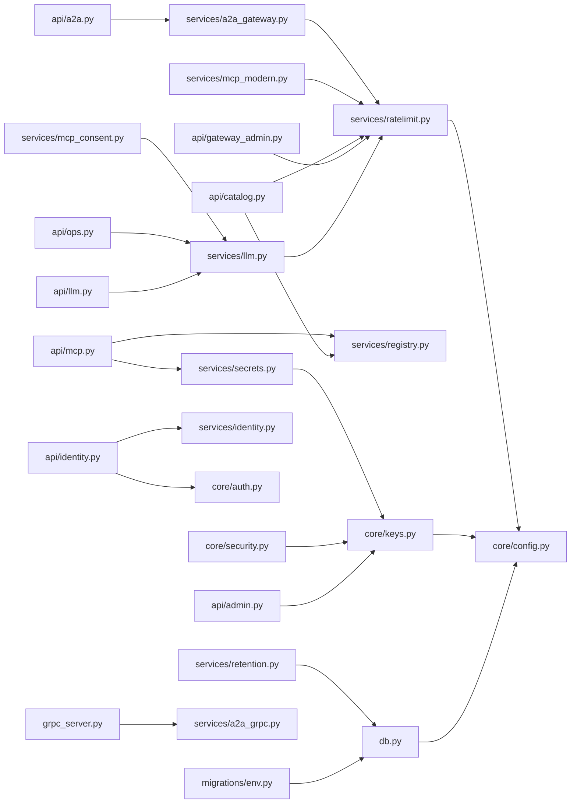
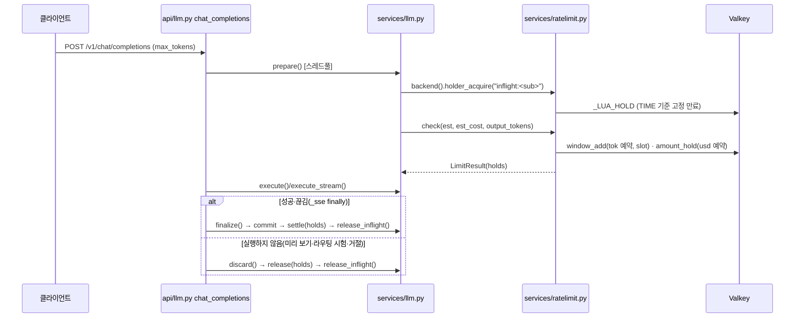

# 코드 단위 리뷰 보고서 (4차) / Line-by-Line Code Review — Round 4
> 분석일 / Date: 2026-10-08 · 대상 / Target: `/Users/wise/Developer/wise-AgentNexus` — 13차 구현(D22, Epic 61~64·66) 변경분
> 리뷰 레벨 / Level: 2 — ~3년 주니어 인수인계 수준 · 파일 / Files: D22 표시가 있는 파일 28개(표시 63개) 전부 + 같은 차수에 표시 없이 바뀐 Helm 5개(`templates/secret.yaml`·`templates/configmap.yaml`·`templates/demo.yaml`·`deploy/helm/check-rendered.py`·`ci/ha-values.yaml`) + 근거용 인접 파일(§1.2) → 보고서 11건(파일별 10 + [INFRA.md](INFRA.md) 1) · 분석 / Analyst: Claude
> 방법: `wds-review` code-method(`~/.claude/plugins/cache/wise-vibe/wise-vibe/2.0.0/skills/wds-review/references/code-method.md`) Step 1–8, Level 2 매트릭스 · **블록 모드** — 표시된 hunk 와 판단에 필요한 주변 코드만 인용·분석(파일 전체 라인 워크 아님) · 인용 코드는 스냅샷 원문에서 기계적으로 복사(줄 번호 = 스냅샷 줄 번호) · 3차 보고서(`.review/round3/CODE-REVIEW-Lv2/`)·`.review/round3/VERIFY.md`·`test/impl/{61st..64th,66th}/` 와 대조
> **범위 고지(scope note).** 이번 리뷰는 **D22 hunk 한정**이다 — 대상은 `grep -rn "D22-" app deploy migrations .env.example` 로 찾은 표시 63개와, 같은 차수에 표시 없이 바뀐 Helm 파일 5개다. 표시 밖의 코드는 hunk 판단에 필요할 때만 읽었고, 그때 찾은 결함은 "인접" 으로 구분했다. 파일 전체 품질 등급이 아니라 **변경분과 그 경계의 등급**이다. D22-⑤(4차 품질 검토, Epic 65)가 이 보고서다(`docs/implementation-plan.md:72` — TODO).
>
> **스냅샷 고지.** 줄 번호·인용은 **2026-10-08 14:27:56 KST 스냅샷** 기준(sha1 목록: 세션 scratchpad `r4/snapshot.sha`, 대상 41개). 리뷰 중 소스는 수정되지 않았다(요청 전제 — §1.4 에서 해시 재확인).

---

## 1. 변경 영역 인벤토리 / Inventory of the Changed Area

### 1.1 범위 — 결정 항목별 (`PRD.md:103`, `docs/implementation-plan.md:68-73`)
| 결정 | Epic · impl | 내용 | 표시 수 | 리뷰 위치 |
|---|---|---|--:|---|
| D22-① 데이터 계층 견고성 | 61 · `test/impl/61st` | PostgreSQL 문장·잠금·유휴 트랜잭션 상한(env), 마이그레이션은 상한 해제, 인덱스 `spans(parent_id, trace_id)`·`run_events(type, ts)`(0021), 표본 정렬 | 9 | [db.py.md](app/db.py.md) · [INFRA.md](INFRA.md) |
| D22-② 키 관리 보강 | 62 · `62nd` | generation 카운터·회전 flock, env 2단계(`*_NEXT`)·공개키 PEM·검증 끝·폐기 kid, 회전 감사 선기록, Helm `rotationNonce` | 11 | [keys.py.md](app/core/keys.py.md) · [INFRA.md](INFRA.md) |
| D22-③ 한도 예약 정밀화 | 63 · `63rd` | 분 슬롯 반환, 출력 토큰 예약·미사용 반환, 주체별 진행 중 상한, Valkey 시계, `any` 예산 현황, `discard` | 19 | [ratelimit.py.md](app/services/ratelimit.py.md) · [llm.py.md](app/services/llm.py.md) |
| D22-④ 경계 하드닝 4 | 64 · `64th` | 대상 Access Token 스코프 ⊆ 교환 정책, 푸시 JWKS 재조회·prod https·issuer 표시, artifacts 상한, OpenAPI 시크릿 409·정리, Inspector 드라이런 등급, 익명 검색 SQL·한도, 소유자 없는 항목, gRPC readiness 공유 | 13 | [identity.py.md](app/api/identity.py.md) · [a2a_gateway.py.md](app/services/a2a_gateway.py.md) · [mcp.py.md](app/api/mcp.py.md) · [catalog.py.md](app/api/catalog.py.md) · [a2a_grpc.py.md](app/services/a2a_grpc.py.md) |
| D22-⑥ 남은 기록 항목 2 | 66 · `66th` | 프로브 리슨 주소, listen 반납 비차단, IdP 내장 issuer 거부·세션 종료 공용화, a2a-grpc TLS 오버레이, readiness 완화, CLI 0700·fchmod, 반입 구성 복원 기본 끔, 헬스 varint | 11 | [a2a_grpc.py.md](app/services/a2a_grpc.py.md) · [identity.py.md](app/api/identity.py.md) · [nexus.py.md](app/cli/nexus.py.md) · [INFRA.md](INFRA.md) |

D22-⑤(4차 품질 검토)는 표시가 없다 — 이 보고서다.

### 1.2 파일 목록 (번호 = 보고서 번호)
| # | 보고서 | 대상 파일 (스냅샷 LOC, 3차 스냅샷 대비) | 표시 hunk | 모드 |
|--:|---|---|---|:--:|
| 01 | [app/core/keys.py.md](app/core/keys.py.md) | `app/core/keys.py`(277, 232→) + `app/api/admin.py`(618) 키 회전 절 L523-618 + `app/core/config.py`(106) L38-47 + `SECURITY.md:48-59` | D22-② 5 + 1 + 1 | block |
| 02 | [app/services/ratelimit.py.md](app/services/ratelimit.py.md) | `app/services/ratelimit.py`(484, 403→) + `app/api/gateway_admin.py`(836) L491-502 | D22-③ 8 + 1 | block |
| 03 | [app/services/llm.py.md](app/services/llm.py.md) | `app/services/llm.py`(499, 471→) + `app/api/llm.py`(543) L56-136 + `app/api/ops.py`(1039) L559-573 + `app/services/mcp_consent.py`(346) L91-206 + `app/core/config.py:25-26` | D22-③ 4 + 1 + 2 + 1 | block |
| 04 | [app/api/identity.py.md](app/api/identity.py.md) | `app/api/identity.py`(540, 519→) + `app/core/auth.py` L197-231 + `app/services/identity.py` L186-198 | D22-④⑥ 4 | block |
| 05 | [app/services/a2a_gateway.py.md](app/services/a2a_gateway.py.md) | `app/services/a2a_gateway.py`(998, 956→) + `app/api/a2a.py`(759, 751→) 등록·PATCH·목록 | D22-④ 2 + 2 | block |
| 06 | [app/api/mcp.py.md](app/api/mcp.py.md) | `app/api/mcp.py`(813, 791→) Inspector·OpenAPI + `app/services/secrets.py` L57-71 + `app/services/registry.py` L276-287 | D22-④ 3 | block |
| 07 | [app/api/catalog.py.md](app/api/catalog.py.md) | `app/api/catalog.py`(768, 758→) `/v0` + `app/services/registry.py`(603, 591→) 검색 | D22-④ 3 + 1 | block |
| 08 | [app/services/a2a_grpc.py.md](app/services/a2a_grpc.py.md) | `app/services/a2a_grpc.py`(337, 309→) + `app/grpc_server.py`(48, 46→) | D22-④⑥ 2 + 1 | block |
| 09 | [app/db.py.md](app/db.py.md) | `app/db.py`(87) + `migrations/env.py`(49) + `migrations/versions/0021_span_event_indexes.py`(23, 신규) + `app/models.py:516`·`:827` + `app/api/observe.py`(492, 489→) + `app/core/config.py:20-24` · 근거 `app/services/retention.py`·`app/services/audit.py`·`app/seed.py` | D22-① 1 + 1 + 1 + 2 + 1 + 1 | block |
| 10 | [app/cli/nexus.py.md](app/cli/nexus.py.md) | `app/cli/nexus.py`(823, 804→) + `app/services/mcp_modern.py`(517, 507→) L57-81 + `app/api/mcp.py:233-241` | D22-⑥ 3 + 1 | block |
| 11 | [INFRA.md](INFRA.md) | Helm `templates/{secret,configmap,api,demo,a2a-grpc}.yaml`·`values.yaml`·`ci/ha-values.yaml`·`check-rendered.py` · `deploy/compose/a2a-grpc-tls.example.yml`(신규) · `.env.example`·`.env.local`·`.env.prod` · `.gitignore` | D22-①②③⑥ 1 + 1 + 4 + 1 + 3 (+ 표시 없는 5개) | block(요약) |

- 근거용으로 함께 읽은 인접 파일(인용·`path:line` 근거만, 등급 없음): `app/core/security.py`, `app/core/http.py`, `app/services/retention.py`, `app/services/audit.py`, `app/services/scheduler.py`, `app/seed.py`, `app/services/a2a_proto.py`, `app/services/orchestrator.py`(모델 호출 헬퍼), `docker-compose.yml`·`docker-compose.prod.yml`·`Dockerfile`, `README.md:251-253`·`:535`, `web/src/pages/a2a/A2A.tsx:328`.
- 디렉터리 개요(`*_Abstract.md`)는 hunk 한정 범위라 만들지 않았다(3차와 같음 — 보고서끼리만 링크).

### 1.3 작업공간·구조 요약 (Step 1–2, 변경 경계 중심)
- 인벤토리: Python 3.12 FastAPI 백엔드 `app/` 83개 파일(약 25.7k 줄 — `api` 17·`services` 38·`core` 12·`cli` 3·`builtin` 7 + 루트 `app/db.py`·`app/models.py`·`app/main.py`·`app/seed.py`·`app/grpc_server.py`), 시험 `test/test_*.py` 60개, Alembic 마이그레이션 21개(이번 0021), Helm 템플릿 9개, 콘솔 `web/src` TS/TSX 46개. 매니페스트 `pyproject.toml`(`requires-python >=3.12`)·`uv.lock`. 진입점: `app.main:app`(uvicorn), `python -m app.grpc_server`, `nexus` CLI, `scripts/entrypoint.sh`(마이그레이션·시드).
- 이번 변경이 닿는 내부 의존(2.2 축약):

- 한도 예약의 생애(2.3 — D22-③ 의 핵심 흐름, 실제 함수명):

- 상태 저장소(2.5 중 이번 변경분): Valkey 키 `anx:h:inflight:`(신규), `anx:w:<key>:<slot>`·`anx:a:usdhold:*`(만료 기준 변경), PostgreSQL 세션 파라미터(연결 옵션), `data_dir/keys/{generation, rotate.lock}`(의미 변경·신규), Helm Secret 키 `*_NEXT`, ConfigMap 키 6개.

### 1.4 보고서 품질 점검 (2026-10-08, 자동)
- 인용 코드 블록 75개는 초안의 `path + 줄 범위` 표기(`@@Q …@@`)에서 스냅샷 원문을 스크립트로 그대로 복사해 만들었다(손으로 옮겨 적지 않음 — 줄 번호 = 원문 줄 번호).
- 본문의 `path:line` 인용 452개(같은 줄의 `:N` 후속 인용 포함)와 보고서 간·3차 보고서 상대 링크 98개를 스크립트로 대조 — 파일 존재·줄 범위 위반 0건. 검사기가 경로로 오인한 표기는 실제 경로가 아닌 이름 3종(런타임 파일 `rotate.lock`·`keys/rotate.lock`, 세션 scratchpad `r4/files.txt`)뿐이다.
- §5 의 지적 25건 각각의 첫 인용 줄을 다시 출력해 대상 코드와 맞는지 눈으로 확인했고, 지적 번호(M1~M5·L1~L20)가 파일별 보고서와 INDEX 양쪽에 빠짐없이 있음을 확인했다.
- 위험 bullet 수(§2)는 렌더 결과에서 다시 세어 표와 일치함을 확인했다(중간 8 · 낮음 32).
- 작성 전후 대상 41개 파일의 sha1 이 스냅샷과 같다(리뷰 중 소스 변경 없음).

---

## 2. 파일별 위험 표 / Per-file Risk
등급은 각 보고서 "파일 평가" 의 위험 등급. Watch-outs 는 라인(블록) 워크 본문의 `- [위험:…]` bullet 수(교차 표기 포함 — 중복을 합친 목록은 §5).

| # | 보고서 | 등급 | Watch-outs 높음/중간/낮음 | 등급 사유 |
|--:|---|:--:|:--:|---|
| 01 | [keys.py + admin.py 키 절](app/core/keys.py.md) | **중간** | 0/3/6 | M3 1단계 파드 재암호화 → 옛 키 제거 시 저장 암호문 손실 · M5 현재 kid 폐기 무효 · L5 drop 잠금 밖 · L6 이전 서명 키 안내 |
| 03 | [llm.py + 호출처](app/services/llm.py.md) | **중간** | 0/2/5 | M1 검증 없는 `max_tokens` 가 예약 산수에 · L1 슬롯·예약 누수 경로 · L4 사용자 단위 상한 · L19 샘플링 실패 미기록 |
| 02 | [ratelimit.py + 예산 현황](app/services/ratelimit.py.md) | **중간** | 0/1/3 | M1 판정 규칙(자기 출력 제외) · L2 예약 더하기 슬롯 · L3 이름 지정 한도 현황 0% |
| 09 | [db.py + 마이그레이션·observe](app/db.py.md) | **중간** | 0/1/4 | M2 세션 상한이 보존 삭제·감사 아카이브를 영구 실패로 · L13 새 인덱스 미사용 가능 · L14 0021 + 잠금 상한 · L15 풀러 · L16 시드 잠금 |
| 04 | [identity.py](app/api/identity.py.md) | **중간** | 0/1/1 | M4 IdP 삭제·중지 뒤 PAT·클라이언트 키 유효(인접) · L8 직접 발급 빈 스코프·TTL |
| 05 | [a2a_gateway.py + a2a.py](app/services/a2a_gateway.py.md) | 낮음 | 0/0/4 | L9 https·issuer 검사가 PATCH 에만 · L10 큰 artifact 하나가 목록 비움·`append` 무시 |
| 11 | [INFRA.md](INFRA.md) | 낮음 | 0/0/4 | L7 existingSecret 1단계 nonce · L6 이전 서명 키 보존 · L18 TLS 키 소유자 |
| 06 | [mcp.py](app/api/mcp.py.md) | 낮음 | 0/0/2 | L11 단계별 커밋·upsert 시크릿·정리 조건 |
| 07 | [catalog.py + registry 검색](app/api/catalog.py.md) | 낮음 | 0/0/1 | L12 익명 한도 키가 프록시 신뢰 설정에 의존 |
| 08 | [a2a_grpc.py + grpc_server.py](app/services/a2a_grpc.py.md) | 낮음 | 0/0/1 | L20 잠금 안 HTTP 대기 |
| 10 | [nexus.py + listen 반납](app/cli/nexus.py.md) | 낮음 | 0/0/1 | L17 매니페스트 밖 구성 백업 복원(인접) |

**분포**: 중간 5 · 낮음 6. bullet 합 높음 0 · 중간 8(고유 5) · 낮음 32(고유 20 + 등급만 둔 관찰 1). 고유 목록은 §5 — [위험:높음] 0건, [위험:중간] 5건, [위험:낮음] 20건.

---

## 3. 위험 핫스팟 Top-5 / Hotspots
1. **한도 예약 — 클라이언트 값이 공용 창을 잠근다(D22-③).** 출력 예약은 클라이언트 `max_tokens`(샘플링은 외부 MCP 서버의 `maxTokens`) 그대로이고, 토큰 한도는 자기 출력 추정을 빼고 판정한다 — 한 사용자가 큰 `max_tokens` 요청 몇 개로 같은 버킷(팀, `any`+`*` 면 전체)의 그 분을 429 로 만든다. 음수면 창을 줄여 한도 우회, 문자열이면 500(M1, `app/services/llm.py:244` ↔ `app/services/ratelimit.py:402-411`). 슬롯 확보 뒤 `ApiError` 가 아닌 예외·시작하지 않은 스트림·커밋 실패에서 예약·슬롯이 만료까지 남고(L1), 예약 더하기에 반환용 슬롯 인자를 써 분 경계에서 조용히 빠진다(L2).
2. **DB 세션 상한 — 요청용 상한이 일괄 작업에도(D22-①).** 문장 120초·잠금 15초가 모든 연결에 걸려, 백로그가 쌓인 보존 삭제(한 문장·한 트랜잭션)는 영영 끝나지 못하고, 감사 아카이브가 체인 머리 행을 잡는 동안 다른 워커의 감사 기록은 15초 뒤 실패한다(M2, `app/db.py:49-52` ↔ `app/services/retention.py:29-35`, `app/services/audit.py:128-131`). 같은 상한이 0021 인덱스 생성 중 옛 파드 INSERT(L14)와 동시 기동 시드(L16)를 실패시킨다.
3. **키 회전 운영 — 코드는 맞고 절차가 새는 곳(D22-②).** env 2단계 중 재암호화가 1단계 파드에 닿으면 옛 키로 다시 써 `failed: 0` 을 돌려주고, 절차대로 옛 키를 지우면 저장 암호문 전체를 잃는다(M3, `app/api/admin.py:547`, `:610-618`, `SECURITY.md:53-58`). 현재 키 kid 를 폐기 목록에 넣으면 경고 없이 무효(M5). existingSecret 1단계 nonce 누락(L7), 이전 서명 키 안내 불일치·Helm 보존 누락(L6), drop 잠금 밖(L5).
4. **신원 해제 범위(D22-④⑥ 인접).** IdP 삭제·중지는 JWT 세션·refresh 만 끊고, 그 사용자 PAT·클라이언트 키는 살아 있다(M4, `app/api/identity.py:262-274` ↔ `app/core/auth.py:198-204`). 직접 발급 대상 토큰의 빈 스코프·TTL 이 교환 규칙과 다름(L8).
5. **검사가 한 진입점에만(D22-④).** push JWKS https·issuer 는 PATCH 입력에만 있고 등록·기존 행·사용 시점에는 없다(L9). OpenAPI 생성은 "확인 → 단계별 커밋 → upsert" 라 동시·감사 실패 경로에서 등록된 서버의 시크릿을 지운다(L11). 익명 발견 한도는 프록시 헤더 신뢰 설정에 달렸다(L12).

---

## 4. 3차 리뷰 대비 / vs 3rd Review (D22 가 다룬 항목)
3차 VERIFY 에서 "기록"·"부분" 으로 남긴 항목 중 13차가 다룬 것.

| 3차 항목 | 4차 상태 | 근거 |
|---|---|---|
| M9 출력 토큰 미예약(기록) | 해결 · 입력 검증 공백(M1) | `app/services/llm.py:243-245`, `app/services/ratelimit.py:402-411` |
| M10 자식 스팬 집계(59th 기간 조건) · 인덱스 | 인덱스 추가 · 질의 모양상 미사용 가능(L13) | `migrations/versions/0021_span_event_indexes.py:17`, `app/api/observe.py:263-266` |
| M12 대상 토큰 스코프(기록 → 13차 사용자 결정) | 해결(부분집합) · 빈 스코프·TTL(L8) | `app/api/identity.py:513-523` |
| L1 mtime 세대 | 해결 | `app/core/keys.py:65-76` |
| L2 env 이전 키(개인키 필수·만료·폐기) | 해결 · 현재 키 폐기 무효(M5) | `app/core/keys.py:137-166` |
| L3 회전 잠금 | 해결(파일 쓰기) · 재암호화+drop 은 밖(L5) | `app/core/keys.py:79-88`, `:264-271` |
| L6 회전 감사 시점·넓은 예외 | 해결 | `app/api/admin.py:598-605` |
| L7 env 롤링 중 옛 파드 | 코드 해결 · existingSecret 1단계 문서(L7) · 재암호화 시점(M3) | `app/core/keys.py:186`, `:201`, `:214`, `SECURITY.md:51-56` |
| L8 지난 분 창 반환 | 해결 · 예약 경계(L2) | `app/services/ratelimit.py:49-59`, `:449-467` |
| L9 `any` 예산 현황 | 해결 · 이름 지정 한도(L3) | `app/services/ratelimit.py:350-365` |
| L13 순서 없는 표본·`run_events` 인덱스 | 해결 | `app/api/observe.py:270`, `app/models.py:516` |
| L15 artifacts 상한 | 해결 · 큰 항목·append(L10) | `app/services/a2a_gateway.py:353-364` |
| L17 issuer 없는 설정·kid 재조회·https | 해결(PATCH·표시·재조회) · 등록·사용 시점(L9) | `app/services/a2a_gateway.py:839-871`, `app/api/a2a.py:399-400`, `:564-568` |
| L18 readiness 증폭·길이 1바이트(+ CR3-04) | 해결 · 대기 줄(L20) | `app/services/a2a_grpc.py:279-322` |
| L19 프로브 127.0.0.1 · TLS 면 TCP | ① 해결 · ② 기록 유지 | `app/grpc_server.py:26-34` |
| L20 OpenAPI 시크릿 덮어쓰기·잔존 | 해결(순차) · 동시·감사 실패(L11) | `app/api/mcp.py:637-695` |
| L21 Inspector 드라이런 등급 | 해결 | `app/api/mcp.py:499-502` |
| L22 동기 Valkey listen 반납 | 해결 | `app/services/mcp_modern.py:74-80` |
| L23 IdP 비활성·삭제 기준·내장 issuer·IN 상한 | 해결 · PAT 잔존(M4) | `app/api/identity.py:219-220`, `:262-274` |
| L24 익명 `/v0/servers?search=` | 해결 · 한도 키(L12) | `app/api/catalog.py:516-524`, `app/services/registry.py:410-415` |
| L25 소유자 없는 항목 새 버전 | 해결 | `app/api/catalog.py:541-544` |
| L27 existingSecret 체크섬 상수 | 해결(nonce + 불변식) · GitOps 키 재생성은 기록 유지 | `deploy/helm/agentnexus/templates/api.yaml:21-23`, `deploy/helm/check-rendered.py:121-123` |
| L28 compose a2a-grpc TLS 볼륨 | 예시 추가 · 키 파일 소유자(L18) | `deploy/compose/a2a-grpc-tls.example.yml:8-14` |
| L29 readiness 가 DB 장애조치에 묶임 | 완화 | `deploy/helm/agentnexus/templates/a2a-grpc.yaml:51` |
| L30 CLI 경로 chmod·0755 | 해결 | `app/cli/nexus.py:50-58` |
| L33 반입 구성 복원 기본 켜짐(3차 VERIFY 판정 정정) | 해결 · 매니페스트 밖 파일(L17) | `app/cli/nexus.py:733-734`, `:805` |
| L35 보유자 만료 워커 시계 · 한 사람이 팀 예산 잠금 | 해결(Valkey TIME · 진행 중 상한) · 크기로는 가능(M1) | `app/services/ratelimit.py:129-160`, `app/services/llm.py:246-251` |
| (D21-⑤ 기록) DB 세션 상한 | 적용 · 일괄 작업 부작용(M2) | `app/db.py:49-52` |

---

## 5. 수정 대상 지적 목록 / Findings for Fixers
- 줄 번호는 **스냅샷 기준**. 같은 근본 원인은 한 행으로 합치고 관련 위치를 함께 적었다. "인접" = D22 표시 밖이지만 hunk 판단 중 확인한 코드.
- 심각도: **High** = 인증·인가 우회, 공급망 무결성 붕괴, 또는 일상 동작으로 서비스 전체가 막히는 결함 · **Medium** = 조건이 붙는 보안·비용·가용성·데이터 손실 결함 · **Low** = 방어적·운영·정확성.

### 5.1 High
없음. (위임 결함 리뷰의 HIGH 1건 CR4-01 은 이 보고서 L1 — 등급 차이 근거는 부록 D.)

### 5.2 Medium
| # | 위치 | 실패 시나리오 | 최소 수정 |
|--:|---|---|---|
| M1 | `app/services/llm.py:244` → `app/services/ratelimit.py:402-411`(판정 L405) · `app/services/mcp_consent.py:93` | `any`+`*` 한도 `tokens_per_min=200000`(전체 공용 버킷 `tok:<id>:*`) → `chat:use` 사용자 하나가 `max_tokens: 64000` 요청 4개를 동시에 연다 → 각 요청은 자기 출력 추정을 뺀 입력만으로 통과 → 창에 256k 예약 → 그 분이 끝날 때까지 **모든 사용자** 429, 실제 사용은 생성 속도만큼, 매 분 반복 가능. 외부 MCP 서버가 샘플링 `maxTokens` 로 같은 효과. 음수면 예약이 음수라 그 요청이 도는 동안 버킷 한도 우회, 문자열이면 `ValueError` → 500 | `max_tokens`·`maxTokens` 를 정수 ≥1 로 검증(아니면 400), `min(값, Model.context_window)` 로 자르기 · `check` 의 출력 예약은 남은 여유분까지만(`min(output_tokens, max(0, 한도 − (now_used − reserve)))`) · 시험: 큰 값·음수·문자열 |
| M2 | `app/db.py:49-52`(모든 연결에 `statement_timeout`·`lock_timeout`) ↔ `app/services/retention.py:29-35` · `app/services/audit.py:128-131`, `:150-151` ↔ `:56-57` | ① 보존 기간을 줄였거나 스케줄러가 며칠 멈춘 뒤 지울 스팬이 수천만 행 → 첫 DELETE 가 120초 초과로 취소 → 같은 트랜잭션의 logs·usage·run_events 삭제까지 롤백 → 1시간 뒤 반복, 백로그만 증가 → 디스크 고갈(경고 로그뿐). ② 감사 보관 기간을 줄인 첫 아카이브가 체인 머리 행 `FOR UPDATE` 를 잡고 수백만 행을 읽고 지우는 동안, 다른 워커의 모든 `audit.append` 가 15초 뒤 `lock_timeout` → 로그인·키 회전·정책 변경 등 감사를 남기는 요청이 본 작업 커밋 뒤 500 | 보존 삭제를 PK 배치(예: 1만 행)·배치마다 커밋, 또는 보존·아카이브 트랜잭션에 `SET LOCAL statement_timeout = 0`(마이그레이션과 같은 방식) · 아카이브는 청크 단위로 머리 행 잠금 짧게 · `audit.append` 머리 행 대기는 `SET LOCAL lock_timeout = 0` 검토 · 시험: 300ms 상한 엔진에서 보존 정리 |
| M3 | `app/api/admin.py:547`(요청 받은 파드의 첫 키로 재암호화), `:610-618` · `SECURITY.md:53-58` · `app/core/keys.py:214`, `:221-226` | env 2단계 회전 2단계 재배포 직후 `nexus keys reencrypt` → 아직 1단계 파드(`ENCRYPTION_KEY`=A, `ENCRYPTION_KEY_NEXT`=B)에 닿음 → 시크릿·MFA·로그 원문·웹훅 토큰을 **옛 키 A** 로 다시 씀, 응답 `failed: 0` → 5단계대로 `ENCRYPTION_KEY_PREVIOUS`(A) 제거·재배포 → 저장 암호문 전체 복호화 불가(되돌릴 수 없음). 1단계 파드는 `encryption_key_count()` 도 2 로 보고 | `settings.encryption_key_next` 가 설정된 파드는 `reencrypt` 409 · 응답에 첫 키 지문(`sha256(primary)[:12]`) 포함, CLI 가 비교 · 절차 4단계 앞에 롤아웃 완료 확인 · `encryption_key_count` 에서 다음 키 제외 · 시험: NEXT 설정 파드의 재암호화 거부 |
| M4 | `app/api/identity.py:262-274`(인접 — `_end_idp_sessions` 범위) ↔ `app/core/auth.py:198-204` | 협력사 IdP 사용자가 콘솔에서 PAT(기본 90일)를 만든다 → 관리자가 IdP 삭제(응답 `users_signed_out: N`) → 사용자 `status` 는 `active`, PAT 인증은 `tokens_not_before` 를 보지 않음 → 그 PAT·클라이언트 키로 API·게이트웨이 계속 사용 | `_end_idp_sessions` 에서 같은 하위 질의로 `PersonalToken.revoked_at = now`(삭제는 항상, 중지는 정책) 또는 삭제 시 사용자 `status = "disabled"` · 감사에 폐기 PAT 수 · 시험: IdP 삭제 뒤 PAT 401 |
| M5 | `app/core/keys.py:153-166`(폐기 필터가 현재 키 제외), `:186`, `:201` · `SECURITY.md:59` | 현재 서명 키 유출 → 운영자가 절차 6단계대로 그 kid 를 `SIGNING_REVOKED_KIDS` 에 넣고 재배포 → 경고 없이 효과 없음 → 공격자가 그 키로 서명한 임의 사용자(관리자 포함) 토큰이 계속 통과. 문서는 "어디서도 검증하지 않는다" 고 약속 | 현재 kid 가 폐기 목록에 있으면 기동 실패("현재 키가 폐기됨 — 먼저 회전") · `SECURITY.md:59` 에 "현재 키면 2단계 회전을 먼저" · 시험: 현재 kid 폐기 시 `ensure_keys` 실패 |

### 5.3 Low
| # | 위치 | 결함 · 시나리오 | 최소 수정 |
|--:|---|---|---|
| L1 | `app/services/llm.py:246-256`, `:383-387`, `:472-478` · `app/api/llm.py:68-76` · `app/services/mcp_consent.py:195-198` | 진행 중 슬롯 확보 뒤 `check` 의 비 `ApiError` 예외, 비스트림·임베딩·샘플링의 비 `ApiError`·취소, 한 번도 시작하지 않은 스트림 제너레이터, `finalize` 커밋 실패 → 예약·슬롯이 만료(300초·그 분)까지 남음. 슬롯 키가 그 사용자 sub 라 32번 누수면 그 사용자 최대 5분 429 | `prepare` 의 `check` 호출을 `try/except BaseException: discard` 로 · 호출처 `except BaseException` 정리 · `finalize` 정산을 `finally` 로 · 미시작 스트림은 응답 객체에 정산 표시 |
| L2 | `app/services/ratelimit.py:403-404` ↔ `:49-53`, `:202-205` | 슬롯 계산과 예약 더하기 사이에 분이 바뀌면 `window_add` 가 "지난 창" 으로 건너뛰고 0 → 통과했는데 예약 없음, 정산 때 사용량 대부분 누락 | 예약 더하기는 `slot` 없이, `window_add` 가 쓴 슬롯을 반환 |
| L3 | `app/services/ratelimit.py:353-354` ↔ `:299` · `app/api/gateway_admin.py:497-498` | 사용자 **이름**으로 만든 `user` 한도는 집행(sub 버킷)은 되는데 현황은 `user_sub == 이름` 으로 집계해 늘 0% | 저장 때 이름 → sub 정규화 또는 현황에서 조회 |
| L4 | `app/services/llm.py:247` | 진행 중 상한 키가 사용자 sub — 한 사용자의 모든 클라이언트 키·PAT·Host 실행이 32 하나를 공유, 클라이언트 키 연동은 33번째부터 429(13차 전 없던 거절) | 클라이언트 키는 `inflight:key:<token_id>` 또는 README 에 사용자 단위 명시 |
| L5 | `app/core/keys.py:264-271` · `app/api/admin.py:547`, `:614-616` | 재암호화(시작 때 키 묶음 캡처) → drop 사이가 잠금 밖 — 동시 회전·재암호화가 끼면 늦게 K1 으로 다시 쓴 행이 남은 채 K0·K1 삭제 → 영구 복호화 불가(두 관리자 동시 작업 필요) | 재암호화 시작 세대 기록, drop 직전 세대가 바뀌었으면 거부(또는 전체를 `_rotation_lock` 안에서) |
| L6 | `.env.example:25` · `deploy/helm/agentnexus/values.yaml:81` · `deploy/helm/agentnexus/templates/secret.yaml:12` · `app/core/keys.py:137-141`, `:202-203` | env 이전 **서명** 키는 백업·보고서 검증의 유일한 보관처인데 주석은 "토큰 수명 뒤 비움", 차트는 `lookup` 으로 보존하지 않아 values 에서 빠지면 사라짐 → 복원 때 "알 수 없는 서명 키(kid)". EC 키를 넣으면 JWKS 500 | 주석 정정(비우는 것은 이전 암호화 키만), 서명 이전 키 `lookup` 보존, `_public` 에서 RSA 확인 후 아니면 기동 실패 |
| L7 | `SECURITY.md:51`, `:55`, `:58` · `deploy/helm/agentnexus/templates/api.yaml:21-23` | existingSecret 에서 1단계(다음 키 배포)에 nonce 를 안 바꾸면 파드가 다음 키를 읽지 않음 → 2단계 롤링 중 간헐 401·복호화 실패(3차 L7 재현). 마지막 재배포도 같음 | 절차 1·5단계에도 nonce 변경(또는 `kubectl rollout restart`) 명시 |
| L8 | `app/api/identity.py:513-523`, `:473` ↔ `app/services/identity.py:191-198` | 직접 발급 대상 토큰은 빈 스코프 허용(`scope: ""`), TTL 최대 3600초 — 교환은 빈 요청이면 기본값·남는 게 없으면 거부, TTL 은 정책(기본 300초). 빈 스코프를 "무제한" 으로 읽는 MCP 서버에서 정책 밖 권한 | 결정 기록 + 빈 스코프면 `default_scopes` 로 채우기(또는 거부), `min(ttl, pol.ttl_seconds)` 검토 |
| L9 | `app/api/a2a.py:495-496` vs `:561-570` · `app/services/a2a_gateway.py:839-849` | 등록 API 는 `push_verify` 를 검사 없이 저장(https·issuer·`SECRET_MANAGE`), 사용 시점에도 https 확인 없음 → prod 에서 평문 JWKS 로 푸시 서명 검증(경로상 공격자가 JWKS 교체 시 위조 푸시 통과). 13차 전 저장된 `http://` 설정도 그대로 | `_push_jwks` 에서 prod + 비 https 면 `PushRejected`, 등록 경로에 PATCH 와 같은 검사 |
| L10 | `app/services/a2a_gateway.py:356-364`, `:478-480`(인접) | 최신 artifact 하나가 4 MiB 를 넘으면 `break` 로 목록 전체가 빈다(4~8 MiB 결과는 원격 상한 안이라 정상 수신 후 조용히 버림, 이벤트 표시 없음). `append: true` 조각은 마지막 조각만 남음 | 큰 항목은 건너뛰고 `ev["artifacts_truncated"]` 기록, `append` 면 parts 이어 붙이기 |
| L11 | `app/api/mcp.py:637-695` · `app/services/secrets.py:58-69` · `app/services/registry.py:285-286` | 확인·정책·시크릿·등록이 각자 커밋, `secrets.put` 은 upsert → 같은 namespace 동시 요청에서 진 쪽 정리가 이긴 쪽 서버의 시크릿 삭제 · 등록 커밋 뒤 감사 실패도 정리 경로로 가서 등록된 서버 시크릿 삭제 · obo 정책은 실패해도 남고 재시도 scopes 미반영 | 시크릿은 "없을 때만 삽입"(유니크 → 409)·만든 경우에만 정리, 정리 조건은 등록 성공 여부로, 가능하면 한 세션 한 커밋 |
| L12 | `app/api/catalog.py:516-517` · `deploy/helm/agentnexus/values.yaml:29` · `Dockerfile:58` · `app/services/ratelimit.py:25`, `:32-41` | 익명 한도 키 = `request.client.host`. Helm 기본 `forwardedAllowIps: "*"` 면 XFF 위조로 요청마다 새 버킷(한도 무력화 + 메모리 버킷 무한 증가), compose 는 프록시 뒤에서 모든 익명 호출이 버킷 하나 공유(한 클라이언트가 전원 429) | prod 에서 `*` 경고·검증, 메모리 버킷 크기 상한(LRU), compose 문서에 `--forwarded-allow-ips` |
| L13 | `app/api/observe.py:263-270` · `migrations/versions/0021_span_event_indexes.py:17` | 자식 스팬 최대값을 `GROUP BY` 하위 질의로 구해 바깥 조인 조건이 안으로 들어가지 못함 → 기간 안 전체 스팬 집계, 새 `(parent_id, trace_id)` 인덱스는 안 쓰이고 `spans` INSERT 비용만 증가(실행 계획 미확인) | `EXPLAIN` 확인 후 바깥 500행마다 상관 스칼라 하위 질의(`max(k.duration_ms) … WHERE k.parent_id = s.id AND k.trace_id = s.trace_id`) |
| L14 | `migrations/versions/0021_span_event_indexes.py:17-18` · `app/db.py:51` | 일반 `CREATE INDEX` 가 쓰기를 막는 동안 롤링 업그레이드의 옛 파드 `spans`·`run_events` INSERT 가 15초 뒤 `lock_timeout` → 진행 중 실행 이벤트 기록 실패 | `postgresql_concurrently=True` + `autocommit_block()`(advisory lock 해제 맞바꿈 기록) 또는 릴리스 노트에 유지보수 창 |
| L15 | `app/db.py:50-52` | libpq `options` 시작 파라미터는 PgBouncer 기본 설정이 거부(연결 실패), `ignore_startup_parameters` 면 상한이 조용히 미적용, 트랜잭션 풀링이면 무의미 | 풀러 사용 시 주의 문서화, 또는 `ALTER ROLE … SET statement_timeout` 안내 |
| L16 | `app/seed.py:376-377` ↔ `migrations/env.py:31-33` | 동시 기동한 두 번째 파드의 시드가 advisory lock 을 15초 기다리다 `lock_timeout` → initContainer 재시작(스스로 회복, 설치 지연·오류 로그) | 시드 잠금 앞에 `SET LOCAL lock_timeout = 0` |
| L17 | `app/cli/nexus.py:805` ↔ `:750`, `:781`(인접) | 서명된 매니페스트에 없는 `config-backup.json` 도 `--restore-config` 면 복원(해시·서명 확인 없음) → 같은 플랫폼의 예전 정상 백업으로 구성 되돌리기(재생) | 조건을 `"config-backup.json" in ok_files` 로 |
| L18 | `deploy/compose/a2a-grpc-tls.example.yml:4`, `:11` · `Dockerfile:55-56` | 컨테이너 uid 10001 — 운영자가 복사한 0600 호스트 소유 `tls.key` 를 읽지 못해 기동 실패·재시작 반복(예시가 막으려던 증상) | 예시에 `chown 10001`·권한 안내, SELinux 면 `:z` |
| L19 | `app/services/mcp_consent.py:195-198` vs `app/api/llm.py:74-76` | 샘플링 실행 실패는 `discard` 만 — 라우팅 결정·실패 지표가 남지 않아 관측 화면에 안 보임 | `finalize(…, None, None, …, "error")` |
| L20 | `app/services/a2a_grpc.py:314-322`, `:267` | 잠금을 잡은 채 api `/health` 를 최대 2초 기다림 → 그동안 인증 없는 readiness 호출이 줄 서며 RPC 동시 슬롯(256) 점유, api 가 느린 순간 실제 A2A RPC `RESOURCE_EXHAUSTED` 가능 | 잠금 밖 캐시 확인 + 갱신 중이면 직전 값 반환 |

**집계**: High 0 · Medium 5 · Low 20. 등급 없이 본문에만 둔 관찰: 분 창 키·요청 버킷의 워커 시계(`app/services/ratelimit.py:192`, `:199`), Redis/Valkey 5 이상 전제(`app/services/ratelimit.py:130`), 마이그레이션의 `idle_in_transaction` 미해제(`migrations/env.py:31-32`), CLI 디렉터리 경로 chmod(`app/cli/nexus.py:51`), `.gitignore certs/` 비고정(`.gitignore:125`).

---

## 6. 표시 hunk 전수 대조 / Every Marked Hunk
63개 표시 모두 아래 보고서에서 다뤘다(파일 단위).

| 파일 | 표시 줄 | 판단 | 보고서 |
|---|---|---|---|
| `app/core/keys.py` | 66·81·138·201·214 | 정확 — M5(현재 키)·L5·L6 | [keys.py.md](app/core/keys.py.md) |
| `app/core/config.py` | 20·25·43 | 정확(정수 검증) — 영향은 M1·M2·M3 | [db.py.md](app/db.py.md) · [llm.py.md](app/services/llm.py.md) · [keys.py.md](app/core/keys.py.md) |
| `app/api/admin.py` | 601 | 정확(감사 선기록) — M3 은 같은 절 | [keys.py.md](app/core/keys.py.md) |
| `app/services/ratelimit.py` | 50·129·204·352·386·411·451·461 | 슬롯 반환·Valkey 시계 정확 — M1·L2·L3 | [ratelimit.py.md](app/services/ratelimit.py.md) |
| `app/api/gateway_admin.py` | 496 | 정확 — L3 | [ratelimit.py.md](app/services/ratelimit.py.md) |
| `app/services/llm.py` | 38·96·246·280 | M1·L1·L4 | [llm.py.md](app/services/llm.py.md) |
| `app/api/ops.py` | 568 | 정확 | [llm.py.md](app/services/llm.py.md) |
| `app/services/mcp_consent.py` | 113·196 | 정확 — M1(L93)·L19 | [llm.py.md](app/services/llm.py.md) |
| `app/api/identity.py` | 219·265·282·513 | 정확 — M4(인접)·L8 | [identity.py.md](app/api/identity.py.md) |
| `app/services/a2a_gateway.py` | 353·865 | 재조회 정확 — L10 | [a2a_gateway.py.md](app/services/a2a_gateway.py.md) |
| `app/api/a2a.py` | 399·566 | 정확 — L9(등록·사용 시점) | [a2a_gateway.py.md](app/services/a2a_gateway.py.md) |
| `app/api/mcp.py` | 499·637·689 | 드라이런 정확 — L11 | [mcp.py.md](app/api/mcp.py.md) |
| `app/api/catalog.py` | 509·523·541 | 정확 — L12 | [catalog.py.md](app/api/catalog.py.md) |
| `app/services/registry.py` | 410 | 정확(이스케이프 순서) | [catalog.py.md](app/api/catalog.py.md) |
| `app/services/a2a_grpc.py` | 289·314 | varint 정확 — L20 | [a2a_grpc.py.md](app/services/a2a_grpc.py.md) |
| `app/grpc_server.py` | 28 | 정확 | [a2a_grpc.py.md](app/services/a2a_grpc.py.md) |
| `app/db.py` | 49 | 정확 — M2·L15 | [db.py.md](app/db.py.md) |
| `migrations/env.py` | 30 | 정확(순서) | [db.py.md](app/db.py.md) |
| `migrations/versions/0021_span_event_indexes.py` | 1 | L13·L14 | [db.py.md](app/db.py.md) |
| `app/models.py` | 516·827 | 정확(모델·마이그레이션 일치) | [db.py.md](app/db.py.md) |
| `app/api/observe.py` | 270 | 정확 — L13 | [db.py.md](app/db.py.md) |
| `app/cli/nexus.py` | 50·58·734 | 정확 — L17(인접) | [nexus.py.md](app/cli/nexus.py.md) |
| `app/services/mcp_modern.py` | 69 | 정확 | [nexus.py.md](app/cli/nexus.py.md) |
| `deploy/helm/agentnexus/values.yaml` | 61·64·66·83 | L6(L81 주석) | [INFRA.md](INFRA.md) |
| `deploy/helm/agentnexus/templates/api.yaml` | 22 | 정확 — L7(절차) | [INFRA.md](INFRA.md) |
| `deploy/helm/agentnexus/templates/a2a-grpc.yaml` | 51 | 정확 | [INFRA.md](INFRA.md) |
| `deploy/compose/a2a-grpc-tls.example.yml` | 1 | L18 | [INFRA.md](INFRA.md) |
| `.env.example` | 12·16·28 | L6(L25 주석) | [INFRA.md](INFRA.md) |

---

## 7. 종합 분석 / Synthesis (Step 7)

### 7.1 반복 패턴 (3+ 파일)
1. **검사가 한 진입점에만 있다.** push JWKS https·issuer 는 PATCH 에만(L9 — 등록·기존 행·사용 시점 없음), OpenAPI 시크릿 409 는 "확인" 단계에만(L11 — 쓰기는 upsert), 예약·슬롯 반환은 `ApiError` 경로에만(L1), 재암호화는 "어느 파드" 인지 확인 없이(M3), 세션 종료는 JWT·refresh 에만(M4). 3차의 "검사 기준과 사용 기준이 다르다" 가 이번에는 "검사 위치와 사용 위치가 다르다" 로 나타났다. 공통 처방: 검사를 **사용 시점 함수 안**(예: `_push_jwks`, `secrets.put` 의 삽입 전용 변형, `finally`)으로 옮긴다.
2. **전역 기본값 하나가 성격이 다른 경로 모두에 걸린다.** 요청용 DB 상한이 보존 삭제·감사 아카이브·시드·인덱스 생성에(M2·L14·L16), 사용자 단위 동시 상한이 클라이언트 키 연동에(L4), 프록시 신뢰 `*` 가 새 익명 한도에(L12). 새 전역 설정을 넣을 때 "이 값이 닿는 장시간·특수 경로 목록" 을 함께 점검해야 한다.
3. **신뢰하지 않는 값이 산수에 직접 들어간다.** `max_tokens`(클라이언트)·`maxTokens`(외부 MCP 서버) → 예약(M1), 원격 artifact 크기 → 목록 전체 삭제(L10), `X-Forwarded-For` → 한도 키(L12).
4. **문서·주석·차트가 코드 의미 변화를 못 따라간다.** env 이전 서명 키(L6 — 코드는 "보관", 주석은 "비움"), existingSecret 1단계 재기동(L7), 현재 키 폐기(M5 — 문서는 "어디서도", 코드는 현재 키 제외), PRD "한 트랜잭션"(L11), 재암호화 시점(M3).
5. **시험이 순차·정상 경로만 본다.** C62-03 은 다음 키 파드의 재암호화를 보지 않고(M3), C64-04 는 순차 요청만(L11), C63-02 는 작은 `max_tokens` 만(M1), C61-* 는 짧은 질의만(M2), C66-03 은 PAT 를 보지 않는다(M4). 이번 [중간] 5건이 모두 이 공백에서 살아남았다.

### 7.2 계층·경계 위반
- 새 위반 없음. 이월: 서비스 → API import `app/services/scheduler.py:46`, `:120`(2차·3차 기록).
- 구성요소 경계: `app/api/ops.py:564` 의 라우팅 시험이 실제 한도 경로(`prepare` → rps 버킷 차감·예산 알림)를 탄다 — "시험" 이 운영 한도를 조금 쓴다(관찰).

### 7.3 위험 핫스팟 top-5
§3 과 같다: ① 한도 예약(M1·L1·L2) ② DB 세션 상한 vs 일괄 작업(M2·L14·L16) ③ 키 회전 운영(M3·M5·L5·L6·L7) ④ 신원 해제 범위(M4·L8) ⑤ 한 진입점 검사(L9·L11·L12).

### 7.4 삭제 후보
- `app/services/ratelimit.py:404` 의 예약 더하기 `slot=slot` 인자(L2 — 반환 전용 인자를 예약에 씀).
- `app/core/keys.py:225` 의 `encryption_key_next` 합산(M3 — "이전 키 수" 에 다음 키가 섞임).
- 그 밖에 이번 hunk 범위에서 죽은 코드·미사용 export 는 찾지 못했다.

### 7.5 테스트 공백 (우선순위순)
1. `max_tokens` 매우 큼·음수·문자열, 샘플링 `maxTokens` 같은 값(M1). 2. 300ms 상한 엔진에서 보존 정리 대량 행, 아카이브 중 다른 세션의 `audit.append`(M2). 3. `ENCRYPTION_KEY_NEXT` 가 설정된 파드의 `reencrypt` 거부(M3). 4. IdP 삭제 뒤 그 사용자 PAT 401(M4). 5. 현재 kid 폐기 시 기동 실패(M5). 6. 등록 API 의 prod `http://` JWKS 거부(L9). 7. 같은 namespace OpenAPI 동시 생성(L11). 8. `check` 예외·미시작 스트림 뒤 슬롯 0(L1). 9. 4 MiB 넘는 artifact 하나(L10). 10. 자식 스팬 질의 `EXPLAIN`(L13).

### 7.6 다음 단계 (영향순)
1. **M1** — `app/services/llm.py`(검증·상한)와 `app/services/ratelimit.py`(여유분 예약)를 함께. 샘플링 `_body` 도 같은 검증 함수.
2. **M3·M5** — `app/api/admin.py`(1단계 파드 재암호화 거부·지문), `app/core/keys.py`(현재 kid 폐기 시 기동 실패, NEXT 합산 제외), `SECURITY.md` 4·6단계 문구. 키 손실·위조는 되돌릴 수 없으므로 문서보다 코드 거부가 먼저.
3. **M4** — `_end_idp_sessions` 에 PAT 폐기(또는 사용자 비활성) + 시험.
4. **M2** — 보존 삭제 배치화(또는 `SET LOCAL`), 아카이브 청크화, 시드·감사 잠금 대기 예외(L16 포함).
5. **절차 문서** — L6·L7·L18(주석·nonce·키 파일 권한), L15(풀러).
6. Low 는 §5.3 순서대로 같은 파일끼리 묶어서.

---

## 부록 / Appendix (Step 8)
- **A. 대상·스냅샷**: 표시 검색 명령은 범위 고지 참고(28개 파일 63개 표시 — D22-① 9 · ② 11 · ③ 19 · ④ 13 · ⑥ 11, ⑤ 0). 스냅샷 해시·시각·대상 목록은 세션 scratchpad `r4/snapshot.sha`·`r4/snapshot.time`·`r4/files.txt`(저장소 밖, 41개). 인용 코드 블록은 스냅샷 원문에서 줄 범위로 기계적으로 복사했다(§1.4).
- **B. 근거 문서**: `PRD.md:103`(D22), `PRD.md:261`(결정 이력), `docs/implementation-plan.md:68-73`, `test/impl/{61st,62nd,63rd,64th,66th}/{scenario,result}.md`, 3차 [INDEX](../../round3/CODE-REVIEW-Lv2/INDEX.md)·[VERIFY](../../round3/VERIFY.md), `SECURITY.md:36-59`, `README.md:251-253`. 잠금 버전: redis 8.1.0(`uv.lock:1874-1879`), Valkey 이미지 8-alpine(`deploy/helm/agentnexus/values.yaml:106`).
- **C. 용어(Level 2 선택)**: 2단계 회전(two-phase rotation — 새 키를 먼저 "검증·복호화 전용" 으로 모든 파드에 배포한 뒤 서명·암호화 키로 올리는 방식) · 다음 키/이전 키(next/previous key) · 폐기 kid(revoked kid — 서명 키 식별자를 검증 후보에서 영구 제외) · 분 슬롯(minute slot — 분당 토큰 창의 번호 `time // 60`) · 진행 중 상한(inflight cap — 주체별 동시 요청 수 상한, 고정 만료 보유자 집합으로 셈) · 세션 파라미터(session parameter — 연결마다 서버에 설정되는 `statement_timeout` 등) · `SET LOCAL`(트랜잭션 안에서만 유효한 설정) · advisory lock(애플리케이션이 정한 번호로 거는 PostgreSQL 잠금) · upsert(있으면 갱신, 없으면 삽입) · 재생(replay — 정상 서명된 예전 데이터를 다시 제출).
- **D. 위임 리뷰 대조**: 이 작업 중 `.review/round4/delegated/{code-review,security-review}.md`(14:38·14:40 생성, 이 보고서 작성자가 쓴 것 아님)가 생겼다. 병합하지 않고 겹치는 항목만 대조한다.

| 위임 항목 | 위임 심각도 | 이 보고서 | 차이와 근거 |
|---|---|---|---|
| CR4-01 비스트림·임베딩·샘플링 취소 시 슬롯·예약 누수 | HIGH | L1 (Low) | 결함은 같다(위치 목록을 위임 리뷰에 맞춰 넓혔다). 슬롯 키가 그 사용자 sub(`app/services/llm.py:247`)라 누수는 **그 사용자 자신**만 막고, 예약은 고정 만료(예산 300초·토큰은 그 분)라 다른 사람 영향이 제한적 — High 기준(서비스 전체·인가 우회)에 못 미친다 |
| CR4-02 `encryption_key_count` 가 다음 키 포함 | MEDIUM | M3 ④ | 같은 지점. 이 보고서는 숫자 부풀림보다 **1단계 파드가 재암호화하는 경로**(데이터 손실)를 본 결함으로 묶었다 |
| CR4-03 obo 교환 정책 고아 행 | MEDIUM | L11(관찰) | 같은 지점. 서버 없는 `api:<ns>` 정책은 받는 쪽이 없어 권한 확대가 아니다 — 재시도 시 scopes 미반영만 남아 Low |
| CR4-04 현재 kid 폐기 무효 | MEDIUM | M5 (Medium) | 같다. 이 보고서 초안은 분석 문장으로만 적었다가(`app/core/keys.py:149-166` 절) 절차 문구(`SECURITY.md:59`)와의 불일치를 확인해 지적으로 올렸다 |
| CR4-05 `list_users` LIKE 미이스케이프 | LOW | (범위 밖) | `app/api/identity.py:143-144` 는 D22 표시 밖·이번 변경 밖 |
| CR4-06 Lua `TIME` — Redis < 7 | LOW | 관찰(등급 없음) | Redis 5 부터 스크립트 효과 복제가 기본이라 경계는 5 로 본다. 차트·compose 는 Valkey 8 |
| CR4-07 디렉터리 경로 chmod | LOW | 관찰(등급 없음) | 같은 지점. 사용자 홈 아래라 실질 위험 없음 |
| SEC4-01 익명 한도 XFF 우회 | MEDIUM | L12 (Low) | 같은 지점. 익명 발견은 설계상 공개 API 이고 검색이 이제 SQL 페이지라 부하가 작다 — 가용성 한정이라 Low. 이 보고서는 compose 공용 버킷·메모리 버킷 증가를 더했다 |
| SEC4-02 JWKS 강제 갱신 한도가 프로세스별 | LOW | (지적 안 함) | 동의하나 30초 × 프로세스 수 정도의 증폭이라 별도 항목으로 올리지 않았다 |
| (없음) | — | M1·M2·M3·M4, L9 등 | 위임 리뷰에 없는 항목 — 특히 M1(`max_tokens` 예약 잠금), M2(DB 상한 vs 일괄 작업), M3(1단계 파드 재암호화), M4(IdP 삭제 뒤 PAT). 위임 보안 리뷰는 "prod https 정상"(`app/api/a2a.py:565-568`)으로 봤으나 등록 경로가 빠져 있다(L9) |
